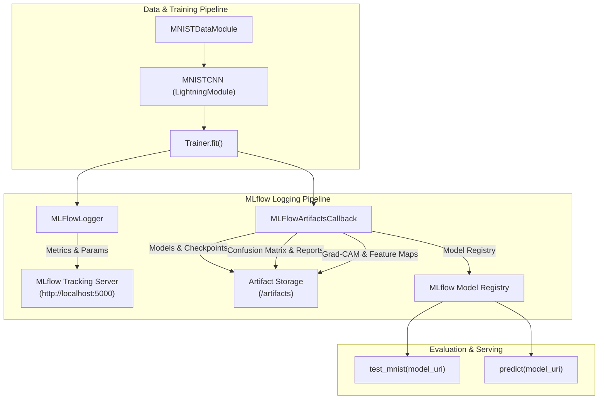

# Implementation Plan: MLflow Integration for `models.MNIST`

This plan details the end-to-end integration of **MLflow** into the `models.MNIST` PyTorch Lightning pipeline. It connects the training, testing, and interpretability mechanisms to the project's existing MLOps infrastructure (MariaDB backend store and MLflow tracking server defined in [`docker-compose.yml`](file:///Users/frankelliott/Documents/Projects/Python/interpetability/docker-compose.yml)).

---

## 1. Objectives & Architectural Context

The repository already defines an MLOps environment:
- **MariaDB** (`mlops_mariadb` on port `3306`) as the backend database for experiment metadata.
- **MLflow Tracking Server** (`mlops_mlflow` on port `5000`) with persistent artifact storage in `/Volumes/Macintosh HD/mlops_volumes/mlflow`.
- **PyTorch Lightning Pipeline** with a modular CNN architecture, LightningModule hooks, and interpretability methods ([`get_feature_maps`](file:///Users/frankelliott/Documents/Projects/Python/interpetability/src/models/MNIST/model.py#L86), [`get_last_conv_layer`](file:///Users/frankelliott/Documents/Projects/Python/interpetability/src/models/MNIST/model.py#L82)).



---

## 2. Multi-Phase Implementation Plan

### Phase 1: Tracking Configuration & URI Resolution
**Goal**: Provide centralized, robust connection handling for both local development and containerized environments.

1. **Create MLflow utility module** at [`src/models/MNIST/mlflow_utils.py`](file:///Users/frankelliott/Documents/Projects/Python/interpetability/src/models/MNIST/mlflow_utils.py):
   - **`get_tracking_uri(explicit_uri: Optional[str] = None) -> str`**:
     - Check explicit CLI/code parameter.
     - Check environment variable `MLFLOW_TRACKING_URI` (defined in `docker-compose.yml` and `.env`).
     - Fall back to `http://localhost:5000` (host connection to Docker MLflow container).
     - Fall back to local file store `./mlruns` if the remote server is unreachable.
   - **`check_tracking_server(uri: str, timeout: float = 2.0) -> bool`**: Quick health-check before attempting network operations.
   - **`setup_mlflow_experiment(experiment_name: str, tracking_uri: str) -> str`**: Idempotent retrieval or creation of the experiment ID.

---

### Phase 2: Configuration & CLI Updates
**Goal**: Expose MLflow settings via configuration dataclasses and command-line interfaces.

1. **Update [`src/models/MNIST/config.py`](file:///Users/frankelliott/Documents/Projects/Python/interpetability/src/models/MNIST/config.py)**:
   - Add fields to [`MNISTTrainingConfig`](file:///Users/frankelliott/Documents/Projects/Python/interpetability/src/models/MNIST/config.py#L38):
     ```python
     experiment_name: str = "mnist_cnn"
     run_name: Optional[str] = None
     tracking_uri: Optional[str] = None
     log_model: bool = True
     log_interpretability: bool = True
     register_model_name: Optional[str] = None
     ```

2. **Update CLI dispatchers** in [`src/models/MNIST/train.py`](file:///Users/frankelliott/Documents/Projects/Python/interpetability/src/models/MNIST/train.py) and [`src/models/main.py`](file:///Users/frankelliott/Documents/Projects/Python/interpetability/src/models/main.py):
   - Add arguments:
     - `--tracking_uri`: URL of MLflow tracking server (e.g. `http://localhost:5000`).
     - `--experiment_name`: Grouping name for runs (default: `mnist_cnn`).
     - `--run_name`: Optional descriptive run name (e.g. `conv32-64-baseline`).
     - `--register_model`: Target name in MLflow Model Registry (e.g. `MNIST-CNN-Classifier`).
     - `--log_interpretability`: Flag (default: `True`) to log Grad-CAM and feature map plots.

---

### Phase 3: Lightning `MLFlowLogger` & Model Registry Callback
**Goal**: Automate real-time metric logging and seamless model checkpoint registration.

1. **Integrate [`pytorch_lightning.loggers.MLFlowLogger`](file:///Users/frankelliott/Documents/Projects/Python/interpetability/src/models/MNIST/train.py)**:
   - Automatically tracks:
     - All hyperparameters registered via `self.save_hyperparameters()` in [`MNISTCNN`](file:///Users/frankelliott/Documents/Projects/Python/interpetability/src/models/MNIST/model.py#L30).
     - Step-level and epoch-level metrics (`train_loss_step`, `train_loss_epoch`, `train_acc`, `val_loss`, `val_acc`).
     - Hardware and system metrics via MLflow system logging.

2. **Implement `MLFlowLoggingCallback`** (`pytorch_lightning.callbacks.Callback`):
   - **`on_train_end`**:
     - Extract model signature (`mlflow.models.signature.infer_signature`) using sample input `torch.randn(1, 1, 28, 28)`.
     - Log model with MLflow PyTorch flavor:
       ```python
       mlflow.pytorch.log_model(
           pytorch_model=model,
           artifact_path="model",
           signature=signature,
           input_example=sample_input.numpy(),
           registered_model_name=register_model_name,
       )
       ```
     - Log configuration artifact (`config.json`) and raw checkpoint (`model.pt`).

---

### Phase 4: Artifact & Interpretability Logging
**Goal**: Log visual explanations and detailed evaluation artifacts directly to MLflow.

1. **Evaluation Artifacts (in [`src/models/MNIST/test.py`](file:///Users/frankelliott/Documents/Projects/Python/interpetability/src/models/MNIST/test.py))**:
   - Render and log high-resolution **Confusion Matrix** heatmap via matplotlib/seaborn.
   - Log **Classification Report** as both a JSON artifact and a markdown summary table.
   - Log per-class Precision, Recall, and F1 bar charts.

2. **Interpretability & Explainability Logging**:
   - **Feature Maps**:
     - Use [`MNISTCNN.get_feature_maps(tensor)`](file:///Users/frankelliott/Documents/Projects/Python/interpetability/src/models/MNIST/model.py#L86) on representative test samples (one for each digit 0–9).
     - Render feature activation grids for `conv1`, `conv2`, `conv3`, and `conv4`.
     - Log to `mlflow.log_figure(fig, artifact_file="interpretability/feature_maps_digit_<digit>.png")`.
   - **Grad-CAM Saliency Maps**:
     - Hook onto [`MNISTCNN.get_last_conv_layer()`](file:///Users/frankelliott/Documents/Projects/Python/interpetability/src/models/MNIST/model.py#L82) (`conv4`).
     - Compute Grad-CAM heatmaps for correct vs. misclassified examples.
     - Overlay heatmaps on the original 28x28 grayscale inputs and log to `interpretability/gradcam_sample_<idx>.png`.

---

### Phase 5: Loading & Evaluating Models from MLflow URI
**Goal**: Enable direct inference and testing using MLflow run and model registry identifiers.

1. **Update [`test_mnist`](file:///Users/frankelliott/Documents/Projects/Python/interpetability/src/models/MNIST/test.py#L31) and [`predict`](file:///Users/frankelliott/Documents/Projects/Python/interpetability/src/models/MNIST/test.py#L156)**:
   - Accept model paths formatted as:
     - Local filesystem directory: `./results/mnist_cnn`
     - MLflow Run URI: `runs:/<run_id>/model`
     - MLflow Registry URI: `models:/<model_name>/<stage_or_version>` (e.g. `models:/MNIST-CNN-Classifier/Production` or `models:/MNIST-CNN-Classifier/1`)
   - Resolves and loads the model via `mlflow.pytorch.load_model(model_uri)`.

2. **CLI testing command**:
   ```bash
   uv run python -m models.main test --model_dir models:/MNIST-CNN-Classifier/latest
   ```

---

### Phase 6: Testing & Quality Assurance
**Goal**: Ensure MLflow integration is tested automatically in CI/CD and unit tests.

1. **Unit Tests in [`tests/test_mlflow.py`](file:///Users/frankelliott/Documents/Projects/Python/interpetability/tests/test_mlflow.py)**:
   - `test_mlflow_utils_fallback`: Validates local `./mlruns` fallback when remote server is offline.
   - `test_mlflow_logger_step_logging`: Verifies PyTorch Lightning `MLFlowLogger` logs step/epoch metrics to local directory.
   - `test_mlflow_model_and_artifact_logging`: Verifies model artifact saving, signature inference, and reload via `mlflow.pytorch.load_model`.
   - `test_interpretability_artifact_generation`: Verifies feature map extraction and figure logging.

---

## 3. Implementation Step Matrix

| Step | Component | Files Modified / Added | Action |
| :--- | :--- | :--- | :--- |
| **1** | URI & Server Utils | `src/models/MNIST/mlflow_utils.py` | Add tracking URI resolution and connectivity helpers |
| **2** | Configuration | `src/models/MNIST/config.py` | Add MLflow configuration fields to `MNISTTrainingConfig` |
| **3** | Lightning Callback | `src/models/MNIST/mlflow_callback.py` | Implement `MLFlowArtifactsCallback` for models & visualizations |
| **4** | Training Pipeline | `src/models/MNIST/train.py` | Attach `MLFlowLogger` and callback in `train_mnist` |
| **5** | Evaluation & Inference | `src/models/MNIST/test.py` | Add `runs:/` and `models:/` URI loading & artifact plotting |
| **6** | CLI Dispatcher | `src/models/main.py` | Expose `--tracking_uri`, `--experiment_name`, `--register_model` |
| **7** | Unit Testing | `tests/test_mlflow.py` | Implement tests for local file store and artifact logging |
| **8** | Documentation | `doc/md/models/MNIST/MLFLOW_GUIDE.md` | Document workflow with `docker-compose.yml` stack |

---

## 4. Verification Workflow

1. **Start MLflow and MariaDB stack**:
   ```bash
   docker compose up -d mariadb mlflow
   ```
2. **Train with MLflow Tracking & Model Registration**:
   ```bash
   uv run python -m models.main train \
       --epochs 3 \
       --batch_size 64 \
       --report_to mlflow \
       --tracking_uri http://localhost:5000 \
       --experiment_name mnist_cnn \
       --register_model MNIST-CNN-Classifier
   ```
3. **Verify in MLflow UI**:
   - Navigate to `http://localhost:5000`.
   - Inspect logged parameters, training curves, confusion matrix, Grad-CAM overlays, and model registry version.
4. **Evaluate directly from Model Registry**:
   ```bash
   uv run python -m models.main test --model_dir models:/MNIST-CNN-Classifier/latest
   ```
