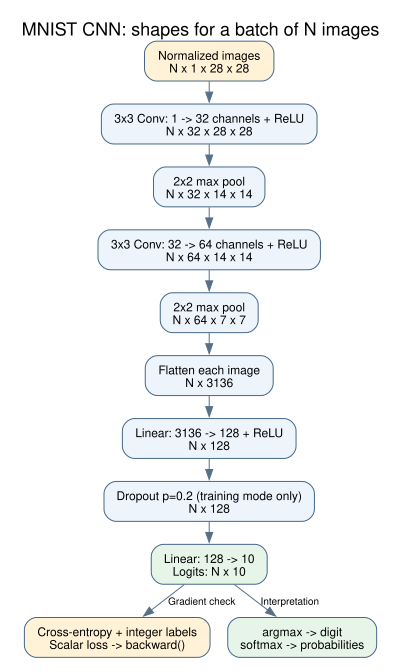

# Review: stage 4 — CNN forward pass and loss

Implemented and verified on 2026-09-29 using the existing Python 3.14.7 environment. The plain PyTorch network lives in `src/mnist_cnn/model.py`; the reusable synthetic inspection lives in `src/mnist_cnn/model_inspection.py`. No dependencies were added.

## Run the demonstration

From the project root:

```bash
uv run --locked mnist-cnn inspect-model --config configs/default.yaml --accelerator cpu --batch-size 7
```

The command creates synthetic grayscale images and digit labels, normalizes the images, instantiates the CNN using `model.dropout`, and records actual layer outputs. It then computes cross-entropy in training mode and calls `backward()` to inspect gradients. It takes **zero optimizer steps** and does not load MNIST, create a checkpoint, or measure model accuracy.

The new run directory contains sanitized `config.yaml` and `model_summary.json` with shapes, parameter count, synthetic loss, and per-parameter gradient checks. Use `--dropout`, `--seed`, and `--batch-size` to explore settings. CPU is the verified baseline; explicit device requests use the existing availability checks.

## Follow one image through the network



`N` is the batch size and stays unchanged. The first convolution learns 32 feature maps; padding preserves the 28 × 28 spatial dimensions. Pooling halves each spatial dimension. The second convolution expands to 64 channels, and a second pooling operation produces 64 × 7 × 7 features per image.

Flattening joins those features into a vector of length 3,136, keeping images separate. The hidden linear layer maps that vector to 128 activations. The output layer produces ten scores, one for each digit. There are **421,642 trainable parameters** across the convolutional and linear layers.

`MNISTCNN.forward()` accepts a nonempty floating-point batch shaped `[N, 1, 28, 28]`. The normal data pipeline supplies float32 tensors; inputs must match the model's dtype and device. Shape and integer-image mistakes produce explicit errors.

## Logits, probabilities, and loss

Logits are unrestricted scores, so they can be negative and need not sum to one. `logits.argmax(dim=1)` selects the highest-scoring digit. If probabilities are needed for later reports, use `logits.softmax(dim=1)`.

Pass the raw logits and int64 labels directly to `torch.nn.functional.cross_entropy`. Cross-entropy already performs the log-softmax calculation; adding softmax inside the network would give it the wrong input representation. [PyTorch cross-entropy reference](https://docs.pytorch.org/docs/2.14/generated/torch.nn.CrossEntropyLoss.html)

Calling `loss.backward()` computes how the loss changes with each parameter and fills its `.grad` tensor. It does not update the parameter values. An optimizer will perform updates in stage 5.

Dropout randomly suppresses activations in training mode. In evaluation mode it leaves them unchanged, making repeated inference on the same input repeatable on the tested CPU setup. `model.eval()` changes dropout behavior; `torch.no_grad()` separately disables gradient recording. [PyTorch dropout reference](https://docs.pytorch.org/docs/2.14/generated/torch.nn.Dropout.html)

## Verification results

Executed:

```bash
uv run --locked pytest -q tests/test_model.py tests/test_cli.py
# 23 passed

uv run --locked pytest -q
# 51 passed, 1 real-data integration check skipped

uv run --locked mnist-cnn inspect-model --config configs/default.yaml --accelerator cpu --batch-size 7 --output-dir runs/stage4-model
```

The saved CPU inspection produced output shape `[7, 10]`, synthetic cross-entropy **2.2900278568267822**, and finite, nonzero gradient norms for every trainable parameter tensor. This is a synthetic wiring check, not evidence of digit-recognition quality. The named run directory now contains evidence; omit `--output-dir` to generate a new directory when repeating the command.

Tests cover batch sizes 1, 7, and 64; finite logits/loss/gradients; unrestricted output scores; the relationship between cross-entropy and log-softmax; dropout behavior; invalid inputs; and the CLI's saved shape report without data acquisition. The regression suite retains the earlier configuration, data, and CLI checks. The real-MNIST integration test was already verified in stage 3; no data pipeline behavior changed here.

For review, read `model.py` beside the diagram, then `tests/test_model.py`. Explain why flattening preserves the batch dimension and why a backward pass is not yet training. Stage 5 will wrap this network in a LightningModule and add optimization and validation.
