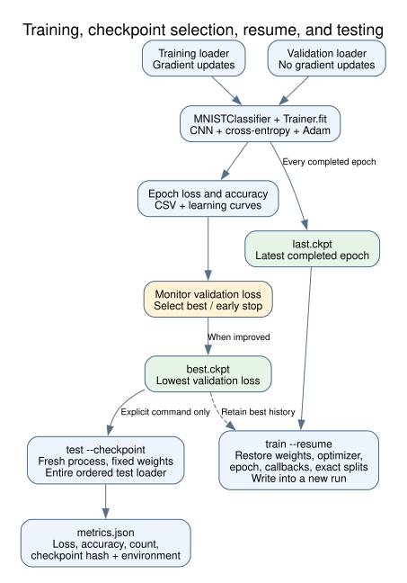

# Training, resuming, and testing

For the complete preliminary walkthrough and which artifacts to present, see [running the preliminary demos](demos.md).

Stages 5–6 add Lightning training and validation, full checkpoints, resume, and standalone test measurement. Run commands from the project root with the existing uv environment. Data preparation is described in [usage](usage.md).

## Train a new run

For the full baseline configuration:

```bash
uv run --locked mnist-cnn train --config configs/default.yaml --no-download --accelerator cpu
```

For a short learning/smoke run:

```bash
uv run --locked mnist-cnn train --config configs/default.yaml --no-download --accelerator cpu --max-epochs 2 --limit-train-batches 20 --limit-val-batches 5
```

The default is full loaders with at most ten epochs. Batch limits are optional positive integers, available in YAML as `trainer.limit_train_batches` and `trainer.limit_val_batches`. Runs using a limit are marked `smoke_run: true` in their summary. A limited run cannot establish the baseline accuracy target. Training never invokes the test loader.

`MNISTClassifier` in `src/mnist_cnn/module.py` wraps the existing CNN. It computes cross-entropy, tracks separate micro-accuracy metrics for each phase, and configures Adam. Lightning's Trainer runs gradient updates and validation. Epoch loss is weighted by the number of examples per batch, so a partial batch has the correct weight. Nonfinite loss raises an error immediately. TorchMetrics counters reset at phase/epoch boundaries.

Validation runs every epoch. The lowest validation loss selects the best checkpoint. Early stopping ends training after three consecutive validation checks without improvement. The `Trainer.fit(..., ckpt_path=...)` API restores a saved training run. [Lightning Trainer reference](https://lightning.ai/docs/pytorch/stable/common/trainer)

## Read the outputs

| Artifact | Purpose |
| --- | --- |
| `config.yaml` | Resolved, sanitized settings |
| `split_indices.json` | Exact train/validation membership |
| `logs/metrics.csv` | Epoch loss and accuracy for training and validation |
| `logs/hparams.yaml` | Lightning's model hyperparameters |
| `learning_curves.png` | Loss and accuracy curves rendered from CSV |
| `checkpoints/best.ckpt` | Lowest validation loss seen so far |
| `checkpoints/last.ckpt` | Most recent completed epoch, even when validation worsens |
| `checkpoints/manifest.json` | SHA-256 hashes of checkpoint files |
| `training_summary.json` | Timing, completed epochs, global step, best epoch, device, environment, and resume lineage |

Summary epoch numbers are 1-based; Lightning checkpoint/CSV epoch indices are 0-based. Training and validation metrics may occupy separate CSV rows for the same epoch. Resume curves show the epochs performed in the new run; the previous run keeps its own curves and metrics.



## Resume into a new run

For the smoke run produced during implementation:

```bash
uv run --locked mnist-cnn train --resume runs/stage5-smoke/checkpoints/last.ckpt --max-epochs 3
```

Replace the path with your own saved run when appropriate. `--max-epochs 3` means three epochs **in total**, not three additional epochs. It must exceed the completed epoch count. A new unique output directory is created unless you supply a new or empty `--output-dir`.

The checkpoint is the source of model, optimizer, normalization, split, and training configuration. Resume restores weights, Adam state, epoch/global step, callback state, exact split membership, and the saved loader generator. CPU torch RNG state is also restored before the next training epoch. Exact uninterrupted equivalence across devices, worker settings, and library versions is not promised; GPU RNG state is not currently persisted.

Keep `best.ckpt` alongside the source checkpoint. The workflow copies the historical best into the new run and remaps the checkpoint callback's paths while retaining its best score. The original run remains unchanged. This prevents a worse resumed epoch from replacing the actual best model. Every completed epoch updates `last.ckpt`, even without a validation improvement.

Resume permits operational overrides: output directory, data-directory/download/worker settings, accelerator, maximum epochs, and supported tracking metadata. It rejects changes to architecture, normalization, split seed, optimizer, batch size, deterministic settings, or smoke batch limits. To start a different experiment, use a new `train` run. Tracking execution remains for stage 8.

Usually omit `--config` for resume/testing and inherit the checkpoint settings. If supplied, YAML is treated as a complete validated profile and checked against the checkpoint; use the saved profile rather than a partial file that unintentionally reintroduces defaults. Explicit CLI overrides take precedence. Changed operational values are recorded in the resumed run's summary.

## Test a fixed checkpoint

The following command measures the full official test dataset. It is available now, but the development plan reserves the baseline test-score measurement for stage 9:

```bash
uv run --locked mnist-cnn test --checkpoint runs/stage5-smoke/checkpoints/best.ckpt --no-download --accelerator cpu
```

Testing works in a fresh process and requires an explicit local checkpoint. Architecture and normalization come from that checkpoint. `--batch-size` may change test batching without changing the measurement; model/training changes are rejected. Training batch limits are never applied to the test loader.

`metrics.json` records test loss, overall accuracy, sample count, checkpoint SHA-256 and path, resolved configuration, package versions, resolved device, and elapsed test time. Test inference disables gradients and dropout and includes every test example. The original checkpoint is not modified. Stage 7 will add per-class metrics and visual error analysis.

Missing, incompatible, or corrupted checkpoints produce a nonzero exit with a clear message. A colocated manifest is verified before loading; standalone checkpoint files without a manifest are still supported and their hashes are recorded. Remote `runs:/` checkpoint retrieval remains for stage 8.

## Focused checks

```bash
uv run --locked pytest -q tests/test_learning.py
uv run --locked pytest -q --run-integration
```

The learning tests use small synthetic datasets, including separate-process test and resume checks. `--run-integration` additionally verifies the real cached data's shapes and split membership; it does not measure the CNN on the official test set. See the [stage 5–6 review](stage-5-6-review.md) for the actual run results.
