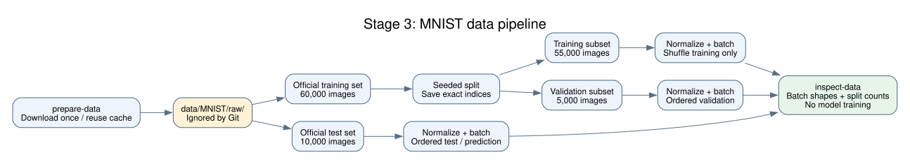

# Command-line usage

For a guided walkthrough of data/model inspection, short CPU training, and resume, see [running the preliminary demos](demos.md).

The current commands validate configuration, download data, inspect data batches, and inspect CNN shapes and gradients using synthetic inputs. Training, resume, and standalone model testing are now available; see [training instructions](training.md). Rich model evaluation remains planned for stage 7; its CLI placeholder exits nonzero.

## 1. Inspect the configuration

```bash
uv run --locked mnist-cnn check-config --config configs/default.yaml --batch-size 32
```

This prints the resolved settings and saves `config.yaml` in a unique directory under `runs/`. Explicit CLI options override YAML, which overrides built-in defaults. For the tracking URI only, precedence is CLI > `MLFLOW_TRACKING_URI` > YAML > default. `check-config` performs no device checks, network calls, or ML computation.

`configs/default.yaml` lists all fields. Integer counts, types, normalization values, seeds, optimizer parameters, dropout, and device/precision choices are validated before work. Unknown and duplicate YAML keys are errors. Model/training settings are validated alongside data settings. The data commands do not build a model. Tracking credentials belong in the environment. Serialized metadata redacts sensitive keys and removes URL credentials and query strings.

## 2. Download MNIST once

```bash
uv run --locked mnist-cnn prepare-data --config configs/default.yaml
```

Torchvision downloads compressed MNIST files, verifies download integrity, and extracts them into `data/MNIST/raw/`. Both the downloaded archives and extracted files remain cached. The project creates no duplicate normalized image dataset: transforms run when a sample is loaded. `/data/` is ignored by Git.

`prepare_data()` acquires or checks the files. It does not create training/validation subsets. `setup()` creates the relevant datasets later, so the same DataModule can work with Lightning's stage lifecycle.

## 3. Inspect the cached dataset

```bash
uv run --locked mnist-cnn inspect-data --config configs/default.yaml --no-download --accelerator cpu
```

This reads the cache and prints split counts, batch shapes, dtypes, and observed pixel/label ranges. It saves:

| File | Meaning |
| --- | --- |
| `config.yaml` | Fully resolved, sanitized settings |
| `split_indices.json` | Exact training and validation membership and seed |
| `data_summary.json` | Split counts and one batch summary for each split |

Training uses 55,000 examples and validation uses 5,000 from the official 60,000-example training dataset. The official 10,000-example test dataset remains separate. Images become float32 tensors shaped `[N, 1, 28, 28]`; labels become int64 tensors shaped `[N]`. Normalization uses `(pixel / 255 - 0.1307) / 0.3081`, so normalized values need not lie in `[0, 1]`.

Only training batches shuffle. Every loader keeps its partial final batch. `split_seed` controls membership independently of global random state and seeds loader order. `trainer.seed` is reserved for model/training randomness in stage 5. Saved membership can be reused explicitly:

```bash
uv run --locked mnist-cnn inspect-data --no-download --accelerator cpu --split-indices runs/stage3-inspect/split_indices.json --num-workers 2
```

That example uses the artifact produced during implementation; replace its path with the `Saved run` location from your own inspection. A saved split must match the configured seed and form a complete, disjoint partition.



## Paths and overrides

Paths are relative to the working directory, so run commands from the project root. Use `--data-dir PATH` to change the cache and `--output-dir PATH` to name an output directory. The output directory must be new or empty; an occupied directory is rejected. Omitting `--output-dir` generates a unique name under `runs/`.

A custom cache outside `data/` needs its own Git ignore rule if it is inside the repository. Use a persistent mounted cache and output directory for later container runs.

Use subcommand help to see supported CLI overrides; all configuration fields are also available through YAML:

```bash
uv run --locked mnist-cnn inspect-data --help
```

`--no-download` guarantees the DataModule will not attempt to download missing files. A missing cache produces instructions to run `prepare-data --download`. Explicit unavailable accelerators fail before downloading or creating a run; inspection defaults to automatic selection. `num_workers=0` is the portable baseline; positive values use persistent workers. Pinned memory is enabled only for CUDA.

MLflow connectivity and logging will be implemented in stage 8. For current data commands, leave tracking disabled; `check-config` can validate a future tracking configuration without connecting to it.

## 4. Inspect the CNN

```bash
uv run --locked mnist-cnn inspect-model --config configs/default.yaml --accelerator cpu --batch-size 7
```

This writes `model_summary.json` with layer shapes, parameter count, synthetic cross-entropy, and gradient checks. It does not download data or update model weights. See the [stage 4 walkthrough](stage-4-review.md) for the architecture diagram and explanation.
