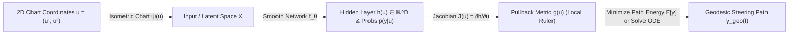

# A Calculus-Based Primer on Riemannian Manifold Steering

**Prerequisite level:** Four semesters of undergraduate calculus—single-variable derivatives and integrals (Calc I–II), multivariable/vector calculus with Jacobians and parameterized surfaces (Calc III), and ordinary differential equations with initial/boundary value problems and basic matrix algebra (Calc IV).

---

## Why Care? Practical Applications of Manifold Steering

Modern AI systems—from Large Language Models (LLMs) and reasoning models to protein generators and robot controllers—store rich internal knowledge inside high-dimensional hidden layers. Yet retraining or fine-tuning billions of weights every time we want to adjust safety boundaries, reasoning depth, tone, or physical constraints is slow, expensive, and prone to catastrophic forgetting.

**Inference-time steering** offers an attractive alternative: nudge the model's internal activations *on the fly* during a forward pass, with zero weight updates. However, naive straight-line vector addition ($h + \alpha v$) treats neural activation space as flat Euclidean $\mathbb{R}^D$. Push $\alpha$ slightly too far and the activation vector leaves the narrow curved surface (*manifold*) of valid representations that the network learned during training—causing garbled text, degraded reasoning, or physically impossible outputs.

**Riemannian manifold steering** keeps interventions *on the manifold* by following curved shortest paths (**geodesics**) measured with the network's own derivatives. Across industry and science, this unlocks six concrete applications:

1. **Test-Time LLM Safety & Alignment Without the "Alignment Tax":** Fine-tuning LLMs for safety or policy compliance often incurs an *alignment tax*—blunting coding, math, or creative utility—while linear steering vectors degrade fluency at strong scales. Steering along on-manifold geodesics lets practitioners dial behavioral traits (honesty, refusal boundaries, formality, domain persona) smoothly at inference time while keeping hidden states inside high-fluency regions without retraining ([Wurgaft et al., 2026](https://arxiv.org/abs/2605.05115); [Oozeer et al., 2026](https://arxiv.org/abs/2605.24942)).
2. **Faithful Chain-of-Thought & Curing "Overthinking" in Reasoning Models:** Large Reasoning Models (such as DeepSeek-R1 and o1-class models) face two inference-time failure modes: logical drift across multi-step proofs, and *overthinking*—redundant verification loops that burn $3\times$–$5\times$ extra compute and latency. Subtracting a single Euclidean vector hits a hard accuracy ceiling due to off-manifold interference noise. Manifold-guided steering (*GeoSteer*, [Kazama et al., 2026](https://arxiv.org/abs/2601.10229), and low-dimensional manifold projection, [Huang et al., 2025](https://arxiv.org/abs/2505.22411)) guides reasoning trajectories along valid logical states, cutting output tokens by **up to 71%** on math, code, and QA benchmarks without sacrificing accuracy.
3. **Controlling Cyclical, Ordered, and Multi-Dimensional Concepts:** Many real-world concepts inside neural networks are *provably non-linear*: calendar dates and months, clock angles, 3D orientations, and ordered severity scales live on closed loops, tori, or curved surfaces rather than straight lines ([Engels et al., 2025](https://arxiv.org/abs/2405.14860)). A straight Euclidean chord across a circle cuts straight through the empty interior! Riemannian geodesics travel naturally *around* the curved concept manifold ([Oozeer et al., 2026](https://arxiv.org/abs/2605.24942)).
4. **Actionable Counterfactual Explanations in Medical & High-Stakes AI:** When a clinical classifier flags a radiology scan or a risk model denies an application, experts ask: *"What is the smallest realistic change to this input that flips the model's decision?"* Euclidean perturbations ($\min_{\delta x}\|\delta x\|_2$) produce adversarial static or anatomically impossible "ghost" organs—just like averaging a `'4'` and a `'9'` creates a double-exposed ghost digit. Boundary-value geodesics under a pullback metric traverse plausible, on-manifold morphology for trustworthy auditing ([Arvanitidis et al., 2018](https://arxiv.org/abs/1710.11379); [Wurgaft et al., 2026](https://arxiv.org/abs/2605.05115)).
5. **Protein Engineering, Directed Evolution & Drug Discovery:** Generative models compress discrete protein sequences and molecular structures into continuous latent spaces to design novel enzymes and therapeutics. Linearly interpolating between two functional proteins slices through "dead zones" of unfolded, non-viable sequences. Decoder pullback geodesics trace biologically viable mutational pathways that preserve structural stability and evolutionary plausibility ([Detlefsen, Hauberg, & Boomsma, 2022](https://arxiv.org/abs/2012.02679)).
6. **Artifact-Free Generative Media & Safe Robotic Motion Planning:** In image, video, and audio synthesis, geodesic latent interpolation eliminates off-manifold "ghosting" ([Arvanitidis et al., 2018](https://arxiv.org/abs/1710.11379)). In robotics, learning a Riemannian skill manifold from human demonstrations lets a robot arm plan collision-free trajectories as geodesics, where obstacles dynamically inflate the local metric $g(u)$ so paths curve safely around hazards ([Beik-Mohammadi et al., 2021](https://arxiv.org/abs/2106.04315)).

| Application Domain | Failure of Linear / Euclidean Approach | What Geodesic Manifold Steering Achieves |
| :--- | :--- | :--- |
| **LLM Alignment & Safety** | Off-manifold drift degrades fluency and reasoning at strong steering scales. | Smooth, training-free control of safety, honesty, and persona without utility loss. |
| **Chain-of-Thought Reasoning** | High-dimensional noise breaks multi-step logic; overthinking wastes tokens. | Preserves step-by-step faithfulness and cuts overthinking tokens by up to 71%. |
| **Cyclic & Curved Concepts** | Chords cut through invalid interiors of circular/curved features (dates, pose). | Follows intrinsic curved geometry cleanly across sequential or periodic states. |
| **High-Stakes Auditing** | Minimum-$L_2$ perturbations yield adversarial static or ghosted superpositions. | Plausible, on-manifold counterfactual trajectories for medical and safety review. |
| **Protein & Drug Design** | Linear latent mixes pass through unfolded, non-functional "dead zones." | Biologically viable mutational paths respecting structural & evolutionary constraints. |
| **Robotics & Media Synthesis** | Ghosted visual morphs; latent robot paths cut into obstacles or joint locks. | Smooth perceptual transitions and obstacle-avoiding geodesic motion skills. |

> [!TIP]
> **The Big Secret of Differential Geometry:** You do *not* need years of abstract topology to understand or build manifold steering. Almost every intimidating word in Riemannian geometry (*manifold, chart, tangent space, pullback metric, volume form, geodesic, Christoffel symbol*) is a clean reorganization of tools you already know from **Calculus II–IV**: arc-length integrals, the multivariable chain rule, Gauss's surface area formula, Taylor approximations, and systems of second-order ODEs.

---

## 0. Your Calculus I–IV Toolkit (What We Will Reuse)

Before introducing any new terminology, here is the exact map between standard calculus objects and their manifold-steering counterparts:

| Calculus Course | Familiar Tool | Formula You Already Know | Role in Manifold Steering |
| :--- | :--- | :--- | :--- |
| **Calc I** | Second derivative & smoothness | $f \in C^2 \implies f''(x)$ is continuous | Why smooth activations ([`SMU`](../../../../src/models/MNIST/model.py#L15-L27), `Softplus`) have well-defined curvature while `ReLU` has corners where $f''$ jumps. |
| **Calc II** | Parametric arc length & Taylor series | $L = \int_0^1 \|\vec{r}'(t)\|_2\,dt$ | Measuring true representational or probability distance along a steering trajectory. |
| **Calc III** | Parameterized surface & Chain Rule | $\frac{d}{dt} h(\gamma(t)) = J_h(\gamma(t))\,\dot{\gamma}(t)$ | Converting a velocity $\dot{\gamma}(t)$ in flat chart coordinates into neuron-space velocity via the Jacobian $J_h$. |
| **Calc III** | Surface area magnification | $dA = \sqrt{EG - F^2}\,du^1 du^2$ | The **Riemannian volume element** $\sqrt{\det g(u)}$, highlighting "semantic cliffs" near decision boundaries. |
| **Calc IV** | 2nd-order ODEs (IVP vs. BVP) | $\ddot{u} = F(u, \dot{u})$ | Solving for **geodesics** either between two fixed endpoints (BVP) or from an initial concept direction (IVP). |

---

## 1. Motivation: What Is "Steering," and Why Do Straight Lines Fail?

### 1.1 Linear Activation Steering
When a trained neural network processes an input $x$ (an image of a handwritten digit or a text prompt), each hidden layer $\ell$ produces an **activation vector** $h \in \mathbb{R}^D$—a list of $D$ numbers summarizing what the network currently "sees" or "means."

**Activation steering** modifies $h$ *at inference time* (without retraining weights) to nudge the model's behavior from a source concept $A$ toward a target concept $B$:
* In an LLM, $A$ might be *"sycophantic tone"* and $B$ *"candid, objective tone"* ([Turner et al., 2023](https://arxiv.org/abs/2308.10248); [Rimsky et al., 2024](https://arxiv.org/abs/2312.06681)).
* In our MNIST demo ([`manifold_steering_demo.py`](../../../../notebooks/manifold_steering_demo.py)), $A$ is a handwritten `'4'` ($x_A$) and $B$ is a handwritten `'9'` ($x_B$).

Standard **linear steering** (*Activation Addition* / *Contrastive Activation Addition*) computes the difference vector $v = h_B - h_A$ and walks along a **straight Euclidean line**:

$$h_{\text{lin}}(t) = h_A + t\,(h_B - h_A) = (1 - t)\,h_A + t\,h_B, \qquad t \in [0, 1].$$

This implicitly assumes the **Linear Representation Hypothesis (LRH)** ([Park et al., 2024](https://arxiv.org/abs/2311.03658)): that concepts live in a flat space where equal vector steps produce equal, clean changes in meaning everywhere.

### 1.2 Three Geometric Ways Straight Lines Break Down
Think of flying from Tokyo to Paris. If you draw a straight ruler line on a distorted flat world map, or bore a straight tunnel through solid rock, your path ignores the geometry of the surface you actually care about. In neural networks, straight lines fail in three ways:

1. **Off-Manifold "Ghosting":** Halfway along the straight line between a `'4'` and a `'9'` ($t = 0.5$), pixel/activation averaging $\frac{1}{2}x_A + \frac{1}{2}x_B$ superimposes two faint ghost digits rather than smoothly closing the top strokes of the `'4'` into the loop of a `'9'`. In LLMs, off-manifold points produce garbled text or sudden topic collapse ([Wurgaft et al., 2026](https://arxiv.org/abs/2605.05115)).
2. **Plateaus and Semantic Cliffs (Non-Uniform Speed):** Deep inside the `'4'` decision basin, moving $t$ from $0.0$ to $0.4$ barely changes the network's output probabilities ($p(\text{'4'}) \approx 0.999$). Then, between $t = 0.48$ and $t = 0.52$, the straight line slices across a razor-thin **decision boundary** where probabilities violently flip and Shannon entropy spikes. A Euclidean ruler treats both intervals as length $0.04$, completely blind to the network's sensitivity!
3. **Curved Feature Surfaces:** Nonlinear layers (convolutions, attention, gated MLPs) bend flat input slices into curved surfaces in downstream layers ([Arvanitidis et al., 2018](https://arxiv.org/abs/1710.11379); [Engels et al., 2025](https://arxiv.org/abs/2405.14860)).

**Manifold steering** fixes this by replacing the blind Euclidean ruler with a **position-dependent ruler** built from the network's own derivatives—and replacing straight lines with **geodesics** (minimum-energy curves that route smoothly through valid representations at a steady semantic pace).

---

## 2. Core Vocabulary: From Calc III Parameterized Surfaces to Manifolds

Let's define each geometric term by translating it directly into Calculus III.

### Definition 1: Manifold ($M$)
* **Formal idea:** An $m$-dimensional **smooth manifold** $M$ is a space that may curve or close up globally (like the 2D surface of a sphere $S^2 \subset \mathbb{R}^3$), but around every point $p \in M$, a small zoomed-in patch can be smoothly flattened onto an open region of ordinary Euclidean space $\mathbb{R}^m$.
* **Calc III translation:** Every smooth 2D parameterized surface $\vec{r}(u^1, u^2)$ in $\mathbb{R}^3$ without self-intersections or sharp creases is a 2D manifold ($m = 2$). Here, instead of $\mathbb{R}^3$, our ambient space is the $D$-dimensional neuron space $\mathbb{R}^D$ (where $D$ might be $128$, $784$, or $4096$).
* **In this repo:** See [`SphereAtlas`](../../../../theory/src/riemannian_manifolds/atlas/sphere.py) and Slide 1 of [`manifold_atlas.py`](../../../../theory/notebooks/manifold_atlas.py#L50-L71).

### Definition 2: Coordinate Chart ($\varphi$) and Parameterization ($\psi = \varphi^{-1}$)
* **Formal idea:** A **chart** assigns flat coordinates $u = (u^1, \dots, u^m) \in U \subseteq \mathbb{R}^m$ to points on a patch of the manifold. Its inverse $\psi = \varphi^{-1} : U \to \mathcal{X}$ maps flat coordinates $u$ back into the high-dimensional space $\mathcal{X}$. When multiple charts overlap to cover a curved space, the collection is called an **atlas**.
* **How Stage 1 builds our 2D chart:** Given three anchor digits $(x_A, x_B, x_C)$ in $784$-dimensional image space ($28 \times 28 = 784$), [`TangentChart2D.from_three_images`](../../../../src/models/MNIST/steering.py#L187-L227) runs **Gram–Schmidt orthonormalization** (from Calc III / Linear Algebra) to build two unit, perpendicular basis images $e_1, e_2 \in \mathbb{R}^{1 \times 28 \times 28}$:
  $$e_1 = \frac{x_B - x_A}{\|x_B - x_A\|_2}, \qquad \tilde{e}_2 = (x_C - x_A) - \langle x_C - x_A, e_1 \rangle e_1, \qquad e_2 = \frac{\tilde{e}_2}{\|\tilde{e}_2\|_2}.$$
  Then any coordinate pair $u = (u^1, u^2) \in \mathbb{R}^2$ decodes via [`TangentChart2D.decode`](../../../../src/models/MNIST/steering.py#L311-L324) to:
  $$\psi(u^1, u^2) = x_0 + u^1 e_1 + u^2 e_2.$$
* **Intuition (Why Orthonormality Matters):** Because $\|e_1\|_2 = \|e_2\|_2 = 1$ and $\langle e_1, e_2 \rangle = 0$, the Pythagorean theorem guarantees
  $$\|\psi(u) - \psi(v)\|_2^2 = \|(u^1 - v^1)e_1 + (u^2 - v^2)e_2\|_2^2 = (u^1 - v^1)^2 + (u^2 - v^2)^2 = \|u - v\|_2^2.$$
  Our flat screen coordinates $(u^1, u^2)$ introduce **zero distortion of their own** (an *isometry* into pixel space). Therefore, every curved boundary and warped distance we see comes $100\%$ from the neural network!

### Definition 3: Immersion ($h$), Tangent Space ($T_u M$), and Jacobian ($J_h$)
Now pass the decoded input $\psi(u)$ into a smooth neural network layer $f_\ell : \mathcal{X} \to \mathbb{R}^D$, defining the composite map:
$$h(u) = f_\ell(\psi(u)) \in \mathbb{R}^D.$$

* **Calc III Multivariable Chain Rule:** Suppose you trace a smooth curve $\gamma(t) = \bigl(u^1(t), u^2(t)\bigr)$ in your 2D chart for $t \in [0, 1]$, with chart velocity $\dot{\gamma}(t) = \bigl(\dot{u}^1(t), \dot{u}^2(t)\bigr)$. How fast is the representation $h(\gamma(t))$ moving inside $\mathbb{R}^D$? By the chain rule:
  $$\frac{d}{dt} h(\gamma(t)) = \frac{\partial h}{\partial u^1}\dot{u}^1(t) + \frac{\partial h}{\partial u^2}\dot{u}^2(t) = J_h(\gamma(t))\,\dot{\gamma}(t),$$
  where $J_h(u) \in \mathbb{R}^{D \times 2}$ is the **Jacobian matrix** of partial derivatives:
  $$J_h(u) = \begin{bmatrix} \dfrac{\partial h^1}{\partial u^1} & \dfrac{\partial h^1}{\partial u^2} \\[0.6em] \vdots & \vdots \\[0.4em] \dfrac{\partial h^D}{\partial u^1} & \dfrac{\partial h^D}{\partial u^2} \end{bmatrix} = \Bigl[\, \partial_1 h(u) \;\Big|\; \partial_2 h(u) \,\Bigr].$$
* **Tangent Space ($T_{h(u)} M$):** As $\dot{\gamma}$ ranges over all 2D directions in $\mathbb{R}^2$, the output velocities $J_h(u)\dot{\gamma}$ sweep out a flat 2D plane sitting tangent to the curved surface $h(U) \subset \mathbb{R}^D$ at $h(u)$, spanned by the two column vectors $\partial_1 h(u)$ and $\partial_2 h(u)$. In geometry, multiplying a chart velocity $\dot{\gamma}$ by $J_h(u)$ is called the **pushforward** (or *differential* $dh_u$).

---

## 3. The Local Ruler: Pullback Riemannian Metrics ($g_{ij}$)

### 3.1 Deriving the Metric Directly from Calc II Arc Length
In Calculus II, the arc length of a curve $t \mapsto h(\gamma(t))$ in $\mathbb{R}^D$ is the integral of its Euclidean speed:
$$L[\gamma] = \int_0^1 \left\| \frac{d}{dt} h(\gamma(t)) \right\|_2 dt.$$

Substitute the Chain Rule $\frac{d}{dt} h(\gamma(t)) = J_h(\gamma(t))\,\dot{\gamma}(t)$ inside the squared norm $\|w\|_2^2 = w^\top w$:

$$\left\| \frac{d}{dt} h(\gamma(t)) \right\|_2^2 = \bigl(J_h \dot{\gamma}\bigr)^\top \bigl(J_h \dot{\gamma}\bigr) = \dot{\gamma}(t)^\top \underbrace{\bigl(J_h(\gamma(t))^\top J_h(\gamma(t))\bigr)}_{g(\gamma(t))} \dot{\gamma}(t) = \sum_{i=1}^m \sum_{j=1}^m g_{ij}(\gamma(t))\,\dot{\gamma}^i(t)\,\dot{\gamma}^j(t).$$

That $m \times m$ symmetric matrix $g(u)$ is the **pullback Riemannian metric**! We "pulled back" the high-dimensional dot product from $\mathbb{R}^D$ down onto our low-dimensional chart $\mathbb{R}^m$ so we never have to leave $u$-coordinates to measure neuron-space lengths.

> [!NOTE]
> **Calc III Déjà Vu (Gauss's First Fundamental Form):** When $m = 2$, write out the $2 \times 2$ matrix $g(u) = J_h(u)^\top J_h(u)$ entry by entry:
> $$g(u) = \begin{pmatrix} g_{11}(u) & g_{12}(u) \\ g_{21}(u) & g_{22}(u) \end{pmatrix} = \begin{pmatrix} \langle \partial_1 h, \partial_1 h \rangle & \langle \partial_1 h, \partial_2 h \rangle \\ \langle \partial_2 h, \partial_1 h \rangle & \langle \partial_2 h, \partial_2 h \rangle \end{pmatrix} = \begin{pmatrix} E & F \\ F & G \end{pmatrix}.$$
> These are the exact coefficients $E, F, G$ from Calculus III surface integrals! And the **Riemannian volume magnification factor**
> $$\sqrt{\det g(u)} = \sqrt{g_{11}g_{22} - g_{12}^2} = \sqrt{EG - F^2}$$
> is literally the Calc III area-stretching factor telling you how much a tiny coordinate square $du^1 du^2$ expands when mapped onto the curved activation surface.

### 3.2 Two Canonical Metrics for Neural Network Steering

Depending on *what* you want your steering path to respect, neural manifold steering uses one of two pullback metrics (both regularized by a tiny constant $\lambda > 0$, typically $10^{-3}$ to $10^{-2}$):

#### 1. Pullback Activation Metric ($g^{\text{act}}$) — Representation Geometry
Pull back the Euclidean geometry of hidden layer $h_\ell(u) \in \mathbb{R}^D$ (see [`pullback_metric_autodiff`](../../../../theory/src/riemannian_manifolds/atlas/autodiff.py#L11-L26)):
$$g^{\text{act}}_{ij}(u) = \bigl(J_{h_\ell}(u)^\top J_{h_\ell}(u)\bigr)_{ij} + \lambda\,\delta_{ij},$$
where $\delta_{ij}$ is the identity matrix ($1$ if $i=j$, $0$ if $i \neq j$).
* **Intuition:** $ds^2 = \delta u^\top g^{\text{act}}(u)\,\delta u \approx \|h_\ell(u + \delta u) - h_\ell(u)\|_2^2$. Regions where hidden neurons fire rapidly in response to $\delta u$ have "tall metric terrain"; regions where neurons barely change are flat.

#### 2. Pullback Fisher Information Metric ($g^{\text{FIM}}$) — Behavioral / Output Geometry
Suppose the network outputs class probabilities $p(y \mid u) = \mathrm{softmax}\bigl(z(\psi(u))\bigr)$ over $C$ classes ($C = 10$ digits in MNIST, or $V$ vocabulary tokens in an LLM), with logit Jacobian $J_z(u) = \frac{\partial z}{\partial u} \in \mathbb{R}^{C \times m}$. How much does a small nudge $\delta u$ change the output probability distribution, as measured by the **Kullback–Leibler (KL) divergence**
$$D_{\text{KL}}\bigl(p(\cdot \mid u) \parallel p(\cdot \mid u + \delta u)\bigr) = \sum_{c=1}^C p_c(u)\,\ln\frac{p_c(u)}{p_c(u + \delta u)}\,?$$

Expand $D_{\text{KL}}$ as a **Calc III second-order multivariable Taylor polynomial** in $\delta u$ around $\delta u = 0$:
* **Zeroth order:** At $\delta u = 0$, $\ln(p_c / p_c) = 0$, so $D_{\text{KL}} = 0$.
* **First order:** Because $D_{\text{KL}} \ge 0$ attains its global minimum at $\delta u = 0$, all first partial derivatives vanish ($\nabla_{\delta u} D_{\text{KL}}\big|_{\delta u=0} = 0$).
* **Second order (the Hessian):** The leading non-zero term is purely quadratic:
  $$D_{\text{KL}}\bigl(p(\cdot \mid u) \parallel p(\cdot \mid u + \delta u)\bigr) = \frac{1}{2}\,\delta u^\top g^{\text{FIM}}(u)\,\delta u + \mathcal{O}(\|\delta u\|^3),$$
  where the **pullback Fisher Information Metric** ([Amari, 2016](https://doi.org/10.1007/978-4-431-55978-8); [`mechanistic_interpretability_geometry.tex`](../../../../theory/mechanistic_interpretability_geometry.tex#L48-L60)) has the closed matrix form:
  $$g^{\text{FIM}}(u) = J_z(u)^\top \Bigl(\mathrm{diag}\bigl(p(u)\bigr) - p(u)\,p(u)^\top\Bigr) J_z(u) + \lambda I_m.$$

* **Intuition:** Look at the middle matrix $\mathrm{diag}(p) - p p^\top$: it is the covariance matrix of a categorical coin flip!
  * **Inside a confident class basin** ($p_{\text{'4'}} \approx 1$, all other $p_c \approx 0$): $\mathrm{diag}(p) - p p^\top \approx 0$, so $g^{\text{FIM}}(u) \approx \lambda I_m$. Moving around inside the `'4'` basin costs almost zero Fisher distance because the network's prediction isn't changing.
  * **Across a high-entropy decision ridge** (e.g., $p_{\text{'4'}} \approx 0.5, p_{\text{'9'}} \approx 0.5$ in [`manifold_steering_demo.py`](../../../../notebooks/manifold_steering_demo.py#L463-L485)): $\mathrm{diag}(p) - p p^\top$ is large, so $g^{\text{FIM}}(u)$ spikes into a steep mountain ridge.
  * **Why add $\lambda I_m$?** In saturated regions where $J_z^\top (\mathrm{diag}(p) - p p^\top) J_z \approx 0$, the raw matrix becomes singular (non-invertible). Adding $\lambda I_m$ guarantees every eigenvalue of $g(u)$ is at least $\lambda > 0$, so $g(u)^{-1}$ always exists and paths stay well-behaved inside flat plateaus ([Arvanitidis et al., 2018](https://arxiv.org/abs/1710.11379)).

### 3.3 Visualizing $g(u)$: Tissot Indicatrices (Metric Ellipses)
At any grid point $u$, what is the set of tiny coordinate steps $\delta u$ that all have the *exact same* small network-distance $r$? Set the quadratic form equal to $r^2$:
$$\delta u^\top g(u)\,\delta u = r^2.$$
From Linear Algebra / Calc III quadric surfaces, because $g(u)$ is symmetric positive-definite, $g(u) = Q \begin{pmatrix}\lambda_1 & 0 \\ 0 & \lambda_2\end{pmatrix} Q^\top$ has orthogonal eigenvectors $q_1, q_2$ and positive eigenvalues $\lambda_1 \ge \lambda_2 > 0$. This equation defines an **ellipse** (a **Tissot indicatrix**) with semi-axes:
$$\text{semi-axis } 1 = \frac{r}{\sqrt{\lambda_1}} \;\text{(high-sensitivity direction)}, \qquad \text{semi-axis } 2 = \frac{r}{\sqrt{\lambda_2}} \;\text{(low-sensitivity direction)}.$$
* Where the ellipse is **squashed thin** along $q_1$, even a tiny step along $q_1$ causes a huge jump in network activations/probabilities (a steep wall).
* Where the ellipse is **stretched wide** along $q_2$, you can glide along $q_2$ without disturbing the network's output.

---

## 4. Geodesics, Kinetic Energy, and Christoffel Symbols ($\Gamma^k_{ij}$)

### 4.1 Arc Length $L[\gamma]$ vs. Path Energy $E[\gamma]$
To steer from $u_A$ at $t=0$ to $u_B$ at $t=1$, we want the **shortest path** under the local ruler $g(u)$. Compare two integrals along $\gamma : [0, 1] \to \mathbb{R}^m$, writing $s(t) = \sqrt{\dot{\gamma}(t)^\top g(\gamma(t))\,\dot{\gamma}(t)}$ for the instantaneous intrinsic speed:

$$\text{Arc Length: } L[\gamma] = \int_0^1 s(t)\,dt, \qquad \text{Kinetic Energy: } E[\gamma] = \frac{1}{2}\int_0^1 s(t)^2\,dt = \frac{1}{2}\int_0^1 \dot{\gamma}(t)^\top g(\gamma(t))\,\dot{\gamma}(t)\,dt.$$

Why does every manifold-steering algorithm minimize **Kinetic Energy $E[\gamma]$** rather than **Arc Length $L[\gamma]$**?
Apply the **Calc II Integral Cauchy–Schwarz Inequality** $\left(\int_0^1 1 \cdot s(t)\,dt\right)^2 \le \left(\int_0^1 1^2\,dt\right)\left(\int_0^1 s(t)^2\,dt\right)$:

$$L[\gamma]^2 \le 1 \cdot \int_0^1 s(t)^2\,dt = 2\,E[\gamma],$$

with equality $L[\gamma]^2 = 2 E[\gamma]$ **if and only if the intrinsic speed $s(t)$ is constant** across the entire interval $t \in [0, 1]$!

> [!IMPORTANT]
> **Why Minimizing Energy $E[\gamma]$ Is Ideal for Steering:**
> 1. **Shortest geometric route:** Any curve that minimizes $E[\gamma]$ automatically minimizes Riemannian length $L[\gamma]$—bending around high-distortion barriers where $\det g(u)$ is huge.
> 2. **Constant semantic speed:** Unlike $L[\gamma]$ (which doesn't care if you dawdle for $90\%$ of $t$ and sprint across the decision boundary in the last $10\%$), minimizing $E[\gamma]$ forces **constant intrinsic speed** $s(t) \equiv L[\gamma]$. Equal slider increments $\Delta t = 0.1$ produce equal amounts of representational/behavioral change!
> 3. **No square-root singularity:** Differentiating $s(t)^2 = \dot{\gamma}^\top g \dot{\gamma}$ has no $\frac{1}{\sqrt{\dots}}$ division-by-zero hazard.

A curve $\gamma(t)$ that is a critical point of $E[\gamma]$ is called a **geodesic**.

### 4.2 Zero-Mystery Calc III Derivation of the Geodesic ODE & Christoffel Symbols
What differential equation does a geodesic satisfy? Let's derive it for an activation surface $h(u) \subset \mathbb{R}^D$ (with $\lambda = 0$ for clean algebra) using only **Newton's Second Law** and the **Calc III Chain & Product Rules**.

Imagine an ant walking along the curved surface $h(u) \subset \mathbb{R}^D$ without turning left, turning right, speeding up, or slowing down. Its ambient acceleration vector $\frac{d^2}{dt^2}h(\gamma(t)) \in \mathbb{R}^D$ may point *perpendicular* to the surface (just to keep the ant glued to the curved surface, like centripetal acceleration on a globe), but it must have **zero component tangent to the surface**:

$$\left\langle \frac{\partial h}{\partial u^l}, \;\frac{d^2}{dt^2} h(\gamma(t)) \right\rangle = 0 \qquad \text{for every coordinate } l = 1, \dots, m.$$

Differentiate our earlier velocity formula $\frac{d}{dt} h(\gamma(t)) = \sum_{j=1}^m \frac{\partial h}{\partial u^j}\dot{\gamma}^j(t)$ one more time with respect to $t$ using the **Product Rule** and **Multivariable Chain Rule**:

$$\frac{d^2}{dt^2} h(\gamma(t)) = \sum_{j=1}^m \frac{\partial h}{\partial u^j}\,\ddot{\gamma}^j(t) + \sum_{i=1}^m \sum_{j=1}^m \frac{\partial^2 h}{\partial u^i \partial u^j}\,\dot{\gamma}^i(t)\,\dot{\gamma}^j(t).$$

Take the dot product of this equation with $\frac{\partial h}{\partial u^l}$, recalling that $\left\langle \frac{\partial h}{\partial u^l}, \frac{\partial h}{\partial u^j} \right\rangle = g_{lj}$:

$$\sum_{j=1}^m g_{lj}(\gamma(t))\,\ddot{\gamma}^j(t) + \sum_{i,j=1}^m \left\langle \frac{\partial h}{\partial u^l}, \frac{\partial^2 h}{\partial u^i \partial u^j} \right\rangle \dot{\gamma}^i(t)\,\dot{\gamma}^j(t) = 0.$$

Finally, multiply on the left by the inverse matrix $g(u)^{-1}$ (whose $(k, l)$ entry is written with upstairs indices $g^{kl}(u)$) to isolate $\ddot{\gamma}^k(t)$. Using the product rule on $g_{jl} = \langle \partial_j h, \partial_l h \rangle$, one checks that $\langle \partial_l h, \partial_i \partial_j h \rangle = \frac{1}{2}(\partial_i g_{jl} + \partial_j g_{il} - \partial_l g_{ij})$—which depends *only* on the metric $g(u)$ itself (meaning it works identically for $g^{\text{FIM}}$ too!). This yields the **Levi-Civita Geodesic ODE**:

$$\ddot{\gamma}^k(t) + \sum_{i=1}^m \sum_{j=1}^m \Gamma^k_{ij}\bigl(\gamma(t)\bigr)\,\dot{\gamma}^i(t)\,\dot{\gamma}^j(t) = 0 \qquad (k = 1, \dots, m),$$

where the **Christoffel symbols of the second kind** $\Gamma^k_{ij}(u)$ are:

$$\Gamma^k_{ij}(u) = \frac{1}{2} \sum_{l=1}^m g^{kl}(u)\left( \frac{\partial g_{jl}}{\partial u^i} + \frac{\partial g_{il}}{\partial u^j} - \frac{\partial g_{ij}}{\partial u^l} \right).$$

* **Intuition for $\Gamma^k_{ij}(u)$ ("Coordinate Drift Correction"):**
  * If $g(u)$ is constant everywhere (flat Euclidean space), all partial derivatives $\frac{\partial g}{\partial u} = 0$, so $\Gamma^k_{ij}(u) = 0$, and the geodesic ODE reduces to $\ddot{\gamma}^k(t) = 0 \implies \gamma(t) = (1-t)u_A + t u_B$ (a straight line!). Thus **$\Gamma^k_{ij} = 0$ is the exact mathematical statement of the Linear Representation Hypothesis** ([`mechanistic_interpretability_geometry.tex`](../../../../theory/mechanistic_interpretability_geometry.tex#L72-L106)).
  * When nonlinear layers bend or stretch the representation space ($\frac{\partial g}{\partial u} \neq 0$), keeping $\ddot{\gamma} = 0$ in flat $u$-coordinates actually forces you to swerve or accelerate inside neuron space! The term $-\sum_{i,j}\Gamma^k_{ij}\dot{\gamma}^i\dot{\gamma}^j$ is the exact counter-steering acceleration your coordinate curve $\gamma(t)$ must apply to stay "truly straight" on the neural manifold.
* **In this repo:** Computed in 9 lines of PyTorch automatic differentiation in [`christoffel_symbols_autodiff`](../../../../theory/src/riemannian_manifolds/atlas/autodiff.py#L28-L52).

---

## 5. Computing Geodesics in Practice: Calc IV Solvers & Activation Smoothness

Just as in Calculus IV (ODEs), a second-order differential equation $\ddot{\gamma}^k = -\sum_{i,j}\Gamma^k_{ij}(\gamma)\dot{\gamma}^i\dot{\gamma}^j$ supports **two natural steering workflows** depending on what boundary conditions you specify:

### 5.1 Boundary Value Problem (BVP) — Steering From Concept $A$ to Concept $B$
* **Boundary conditions:** Fix both endpoints: $\gamma(0) = u_A$ (e.g., `'4'`) and $\gamma(1) = u_B$ (e.g., `'9'`). In differential geometry, the initial velocity $\dot{\gamma}(0)$ that hits $u_B$ at $t=1$ is called the **Riemannian Logarithm map**, $v_0 = \mathrm{Log}_{u_A}(u_B)$.
* **How we solve it numerically (Discrete Midpoint Energy):** Instead of shooting blind rays to hit $u_B$, discretize the curve into $N$ segments $u_0, u_1, \dots, u_N$ (with $u_0 = u_A, u_N = u_B$ fixed, or parameterized via cubic splines as in [StochMan](https://github.com/MachineLearningLifeScience/stochman)) and approximate the energy integral $E[\gamma]$ using the **Calc II Midpoint Rule** at $\bar{u}_n = \frac{1}{2}(u_n + u_{n+1})$:
  $$E_{\text{disc}}(u_1, \dots, u_{N-1}) = \frac{N}{2} \sum_{n=0}^{N-1} (u_{n+1} - u_n)^\top \, g(\bar{u}_n) \, (u_{n+1} - u_n).$$
  We minimize $E_{\text{disc}}$ over the interior waypoints $(u_1, \dots, u_{N-1})$ using quasi-Newton `L-BFGS-B` ([scipy.optimize.minimize](https://docs.scipy.org/doc/scipy/reference/generated/scipy.optimize.minimize.html)).
* **Practical bonus:** Notice that $E_{\text{disc}}$ only evaluates $g(u)$ (first derivatives), never $\Gamma^k_{ij}(u)$! That makes BVP energy minimization fast, numerically rock-solid, and tens of milliseconds on a laptop.

### 5.2 Initial Value Problem (IVP / Geodesic Shooting) — Steering Along Direction $v_0$
* **Initial conditions:** Fix the starting point $\gamma(0) = u_A$ and an initial concept velocity $\dot{\gamma}(0) = v_0$ (for instance, a contrastive vector learned from examples, when you do *not* have a single target point $u_B$). In geometry, the endpoint $\gamma(t)$ reached at time $t$ is called the **Riemannian Exponential map**, $\mathrm{Exp}_{u_A}(t\,v_0)$.
* **How we solve it numerically (Calc IV Phase-Space Reduction):** Convert the $m$ second-order ODEs into $2m$ first-order ODEs in state $(u, v) \in \mathbb{R}^{2m}$:
  $$\begin{cases} \dot{u}^k(t) = v^k(t), \\[0.4em] \dot{v}^k(t) = -\displaystyle\sum_{i,j=1}^m \Gamma^k_{ij}\bigl(u(t)\bigr)\,v^i(t)\,v^j(t), \end{cases} \qquad u(0) = u_A,\quad v(0) = v_0,$$
  and integrate from $t = 0$ to $t = 1$ using adaptive fourth/fifth-order Runge–Kutta (`RK45` in [scipy.integrate.solve_ivp](https://docs.scipy.org/doc/scipy/reference/generated/scipy.integrate.solve_ivp.html)). Notice that if $\Gamma^k_{ij} = 0$, $\dot{v} = 0 \implies u(t) = u_A + t v_0$: geodesic shooting is the exact curved-space generalization of Activation Addition!

### 5.3 Why Smooth Activations (`SMU`, `Softplus`, `GELU`) Beat `ReLU`
Look back at our Calc III derivation of $\Gamma^k_{ij}(u)$: it contains **second partial derivatives** $\frac{\partial^2 h}{\partial u^i \partial u^j}$ of the neural network!
* **What happens with `ReLU`?** From Calculus I, $\mathrm{ReLU}(x) = \max(0, x)$ has first derivative $0$ (for $x < 0$) or $1$ (for $x > 0$), and **second derivative $0$ everywhere** except an undefined kink at $x = 0$. Consequently, a `ReLU` network slices $\mathbb{R}^m$ into flat polyhedral cells: inside every cell, $J_h(u)$ is constant and $\Gamma^k_{ij}(u) = 0$, while *all* curvature is crammed into singular "fold creases" where neurons switch on/off! An ODE solver (`RK45`) computing $\Gamma^k_{ij}(u)$ inside a cell thinks the world is flat until it slams into a crease.
* **What happens with $C^\infty$ smooth activations?** Modern Transformers use smooth activations (`GELU`, `SiLU`/`Swish`), and our MNIST CNN ([`model.py`](../../../../src/models/MNIST/model.py#L15-L39)) supports `Softplus` and the **Smooth Maximum Unit (`SMU`)** ([Biswas et al., 2022](https://arxiv.org/abs/2111.04682)):
  $$\mathrm{SMU}(x) = \frac{1}{2}\Bigl((1 + \alpha)x + (1 - \alpha)x\,\mathrm{erf}\bigl(\mu(1 - \alpha)x\bigr)\Bigr), \qquad \mathrm{erf}(z) = \frac{2}{\sqrt{\pi}}\int_0^z e^{-s^2}\,ds.$$
  Because $e^{-s^2}$ is infinitely differentiable ($C^\infty$), `SMU` smooths the `ReLU` corner into a graceful curve: $g_{ij}(u)$ and $\Gamma^k_{ij}(u)$ vary smoothly everywhere, and both IVP shooting and BVP optimization agree!

---

## 6. Quick-Reference Glossary

| Term | Symbol | Calculus I–IV Translation | One-Sentence Intuition |
| :--- | :---: | :--- | :--- |
| **Manifold** | $M$ | Smooth parameterized surface without creases | A globally curved space that looks locally like flat $\mathbb{R}^m$ when you zoom in. |
| **Chart / Parameterization** | $\varphi,\; \psi = \varphi^{-1}$ | Surface coordinates $(u^1, u^2) \mapsto \vec{r}(u^1, u^2)$ | A flat 2D control pad $u = (u^1, u^2)$ mapped cleanly into 784D image or $D$-dim activation space. |
| **Tangent Space & Pushforward** | $T_p M,\; J_h(u)$ | Span of $\partial_1 h, \partial_2 h$ & Jacobian matrix | Linear map turning chart velocity $\dot{u}$ into neuron-space velocity $J_h(u)\dot{u}$ via the Chain Rule. |
| **Pullback Metric** | $g_{ij}(u)$ | $J^\top J$ (Gauss's $E, F, G$ matrix) | Position-dependent $m \times m$ matrix measuring true network or KL distance for a small step $\delta u$. |
| **Fisher Information Metric** | $g^{\text{FIM}}_{ij}(u)$ | Hessian of $D_{\text{KL}}(p_u \parallel p_{u+\delta u})$ | Local ruler that grows tall where output probabilities change rapidly (decision boundaries). |
| **Volume Magnification** | $\sqrt{\det g(u)}$ | $\sqrt{EG - F^2}$ in surface integrals | Scalar heatmap showing where the network stretches small coordinate regions into large semantic changes. |
| **Tissot Indicatrix** | $\delta u^\top g(u)\delta u = r^2$ | Ellipse from eigenvalues/vectors of $g(u)$ | Visual ellipse at $u$ showing steep directions (squashed axis) vs. neutral directions (long axis). |
| **Path Energy** | $E[\gamma]$ | $\frac{1}{2}\int_0^1 \dot{\gamma}^\top g(\gamma)\dot{\gamma}\,dt$ | Integral minimized to find the shortest manifold path *at constant semantic speed*. |
| **Geodesic** | $\gamma_{\text{geo}}(t)$ | Critical curve of $E[\gamma]$ / zero tangential $\ddot{h}$ | The curved-manifold replacement for a straight line, routing smoothly around high-distortion cliffs. |
| **Christoffel Symbols** | $\Gamma^k_{ij}(u)$ | Metric derivative combination $\frac{1}{2}g^{kl}(\partial_i g_{jl} + \dots)$ | Corrective acceleration terms in $\ddot{\gamma}^k + \Gamma^k_{ij}\dot{\gamma}^i\dot{\gamma}^j = 0$ compensating for how coordinates bend. |
| **Exponential / Log Maps** | $\mathrm{Exp}_p(v),\; \mathrm{Log}_p(q)$ | IVP solution vs. BVP initial velocity | $\mathrm{Exp}_p(t v)$ shoots a geodesic in direction $v$; $\mathrm{Log}_p(q)$ finds the initial velocity needed to reach $q$. |

---

## 7. Clickable References

### A. Workspace Code, Interactive Notebooks & Design Docs
* **Interactive MNIST Stage 1 Demo:** [`manifold_steering_demo.py`](../../../../notebooks/manifold_steering_demo.py) — Orthonormal 2D charts (`Gram–Schmidt` & `TangentPCA`), live probe decoding, classifier decision basins, and Shannon entropy ridges.
* **Stage 1 Steering Primitives:** [`steering.py`](../../../../src/models/MNIST/steering.py) — `TangentChart2D`, `evaluate_decision_landscape`, and `ensure_smooth_checkpoint`.
* **Smooth Activation (`SMU`) & CNN Hooks:** [`model.py`](../../../../src/models/MNIST/model.py) — `SMU` and `MNISTCNN.get_feature_maps`.
* **PyTorch `jacrev` Metric & Christoffel Autodiff:** [`autodiff.py`](../../../../theory/src/riemannian_manifolds/atlas/autodiff.py) — `pullback_metric_autodiff` and `christoffel_symbols_autodiff`.
* **$S^2$ Atlas & Geodesic Presentation:** [`manifold_atlas.py`](../../../../theory/notebooks/manifold_atlas.py) and [`sphere.py`](../../../../theory/src/riemannian_manifolds/atlas/sphere.py).
* **Repository Theory & Architecture Papers:** [`manifold_steering_primer.tex`](../../../../theory/manifold_steering_primer.tex) ([PDF](../../../../theory/manifold_steering_primer.pdf)), [`manifold_steering_design.tex`](../../../../theory/manifold_steering_design.tex) ([PDF](../../../../theory/manifold_steering_design.pdf)), and [`mechanistic_interpretability_geometry.tex`](../../../../theory/mechanistic_interpretability_geometry.tex) ([PDF](../../../../theory/mechanistic_interpretability_geometry.pdf)).

### B. Accessible Differential & Information Geometry Texts (Calculus Bridge)
1. **Frank Morgan (2016)**, *Riemannian Geometry: A Beginner's Guide* (2nd ed., CRC Press) — Builds Riemannian geometry directly out of multivariable calculus and extrinsic surfaces in $\mathbb{R}^N$. [Publisher DOI](https://doi.org/10.1201/9781439863992) · [Local Copy](../../../papers/Riemannian%20Geometry,%20a%20Beginners%20Guide%20-%20F.%20Morgan_text.pdf)
2. **Nicolas Boumal (2023)**, *An Introduction to Optimization on Smooth Manifolds* (Cambridge University Press) — Crystal-clear modern treatment of embedded submanifolds, tangent spaces, retractions, and Riemannian gradients; free official PDF online. [Book Website & Free PDF](https://www.nicolasboumal.net/book/)
3. **Nina Guigui, Nina Miolane, & Xavier Pennec (2023)**, *"Introduction to Riemannian Geometry and Geometric Statistics: From Basic Theory to Implementation with Geomstats,"* *Foundations and Trends in Machine Learning*, 16(3), 329–493 — Connects pullback metrics, $\mathrm{Exp}$/$\mathrm{Log}$ maps, Fréchet means, and `TangentPCA` directly to Python code. [HAL Open-Access Preprint](https://inria.hal.science/hal-03766900v2) · [DOI](https://doi.org/10.1561/2200000098) · [Local Copy](../../../papers/main-now.pdf)
4. **Shun-ichi Amari (2016)**, *Information Geometry and Its Applications* (Springer) — Definitive reference on the Fisher Information Metric, KL divergence Taylor expansions, and dual $e$-/$m$-connections. [Springer DOI](https://doi.org/10.1007/978-4-431-55978-8)

### C. Pullback Metrics & Curved Neural Latent Spaces
5. **Georgios Arvanitidis, Lars Kai Hansen, & Søren Hauberg (2018)**, *"Latent Space Oddity: on the Curvature of Deep Generative Models,"* *ICLR 2018* — The foundational machine-learning paper introducing regularized neural pullback metrics, volume magnification $\sqrt{\det g(u)}$, and minimum-energy latent geodesics. [arXiv:1710.11379](https://arxiv.org/abs/1710.11379)
6. **Søren Hauberg (2018)**, *"Only Bayes Should Learn a Manifold (on the Estimation of Differential Geometric Structure from Data)"* — Explains why deterministic vs. stochastic pullback metrics avoid off-manifold shortcuts. [arXiv:1806.04994](https://arxiv.org/abs/1806.04994)
7. **Koushik Biswas, Sandeep Kumar, Shilpak Banerjee, & Ashish Kumar Pandey (2022)**, *"SMU: Smooth Activation Function for Deep Networks Using Smoothing Maximum Technique,"* *CVPR 2022* — Introduces the $C^\infty$ Smooth Maximum Unit used in our smooth `MNISTCNN`. [arXiv:2111.04682](https://arxiv.org/abs/2111.04682)
8. **Nicki Skafte Detlefsen, Søren Hauberg, & Wouter Boomsma (2022)**, *"Learning Meaningful Representations of Protein Sequences,"* *Nature Communications* 13, 1914 — Uses pullback Riemannian geodesics to trace biologically viable protein mutational pathways without crossing unfolded "dead zones." [arXiv:2012.02679](https://arxiv.org/abs/2012.02679)
9. **Hadi Beik-Mohammadi, Søren Hauberg, Georgios Arvanitidis, Gerhard Neumann, & Leonel Rozo (2021)**, *"Learning Riemannian Manifolds for Geodesic Motion Skills,"* *Robotics: Science and Systems (R:SS)* — Plans smooth, obstacle-avoiding robot motion trajectories as latent pullback geodesics. [arXiv:2106.04315](https://arxiv.org/abs/2106.04315)

### D. Activation Steering, Representation Geometry & Manifold Steering
10. **Alexander Matt Turner et al. (2023)**, *"Activation Addition: Steering Language Models Without Optimization"* — Introduces inference-time linear activation steering ($h + c\,v$). [arXiv:2308.10248](https://arxiv.org/abs/2308.10248)
11. **Andy Zou et al. (2023)**, *"Representation Engineering: A Top-Down Approach to AI Transparency"* — Reading and controlling concepts via linear PCA/contrastive subspaces in hidden representations. [arXiv:2310.01405](https://arxiv.org/abs/2310.01405)
12. **Nina Rimsky et al. (2024)**, *"Steering Llama 2 via Contrastive Activation Addition,"* *ACL 2024* — Mean-difference linear steering vectors across contrastive prompt pairs. [arXiv:2312.06681](https://arxiv.org/abs/2312.06681)
13. **Kiho Park, Yo Joong Choe, & Victor Veitch (2024)**, *"The Linear Representation Hypothesis and the Geometry of Large Language Models,"* *ICML 2024* — Shows why naive Euclidean dot products distort concept geometry and defines causal inner products. [arXiv:2311.03658](https://arxiv.org/abs/2311.03658) · [GitHub](https://github.com/KihoPark/linear_rep_geometry)
14. **Joshua Engels, Eric J. Michaud, Isaac Liao, Wes Gurnee, & Max Tegmark (2025)**, *"Not All Language Model Features Are One-Dimensionally Linear,"* *ICLR 2025* — Demonstrates genuinely curved multi-dimensional feature manifolds (such as circular date/month manifolds) inside LLMs. [arXiv:2405.14860](https://arxiv.org/abs/2405.14860)
15. **Yao Huang, Huanran Chen, Shouwei Ruan, Yichi Zhang, Xingxing Wei, & Yinpeng Dong (2025)**, *"Mitigating Overthinking in Large Reasoning Models via Manifold Steering"* — Projects steering interventions onto low-dimensional reasoning manifolds, reducing output tokens by up to 71% without losing accuracy. [arXiv:2505.22411](https://arxiv.org/abs/2505.22411) · [GitHub](https://github.com/Aries-iai/Manifold_Steering)
16. **Daniel Wurgaft, Can Rager, Matthew Kowal, et al. (2026)**, *"Manifold Steering Reveals the Shared Geometry of Neural Network Representation and Behavior"* — Demonstrates that geodesic steering along intrinsic activation/behavioral manifolds avoids off-manifold collapse and couples representational geometry to output behavior. [arXiv:2605.05115](https://arxiv.org/abs/2605.05115)
17. **Narmeen Oozeer et al. (2026)**, *"Riemannian-Manifold Steering: Geometry-Aware Generative Autoencoders for Label-Free Steering"* — Unifies linear, spline, and output-pullback steering as Riemannian geodesics under different metrics. [arXiv:2605.24942](https://arxiv.org/abs/2605.24942)
18. **Kentaro Kazama, Daiki Shirafuji, & Tatsuhiko Saito (2026)**, *"GeoSteer: Faithful Chain-of-Thought Steering via Latent Manifold Gradients"* — Applies latent manifold geometry to steer multi-step LLM reasoning trajectories reliably. [arXiv:2601.10229](https://arxiv.org/abs/2601.10229)

### E. Python Packages Used in This Stack
* **[PyTorch `torch.func`](https://pytorch.org/docs/stable/func.html)** — Composable `jacfwd`, `jacrev`, `vmap`, and `grad` transforms for exact, vectorized pullback Jacobians and Christoffel tensors.
* **[StochMan](https://github.com/MachineLearningLifeScience/stochman)** — PyTorch library for neural pullback manifolds, `CubicSpline` curves, and discrete geodesic energy optimization.
* **[Geomstats](https://geomstats.github.io/)** ([GitHub](https://github.com/geomstats/geomstats)) — Differential geometry and geometric statistics in Python (`PullbackMetric`, `FrechetMean`, `TangentPCA`).
* **[SciPy Optimize & Integrate](https://docs.scipy.org/doc/scipy/reference/integrate.html)** — `L-BFGS-B` for BVP curve energy minimization and adaptive `RK45` (`solve_ivp`) for IVP geodesic shooting.
* **[NNsight](https://nnsight.net/)** ([GitHub](https://github.com/ndif-team/nnsight)) — Clean PyTorch intervention tracing for extending manifold steering to open-weight Transformers.
