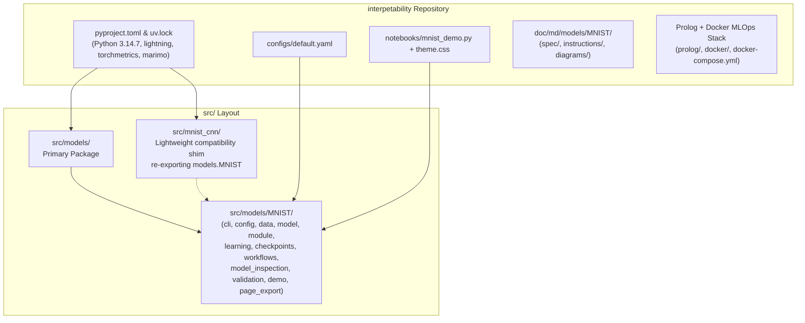

# Integration Plan: `../MNIST_CNN` into `interpetability`

This plan details the step-by-step migration of [`../MNIST_CNN`](file:///Users/frankelliott/Documents/Projects/Python/MNIST_CNN) (Stages 1–6, Marimo interactive notebook, tests, configurations, Graphviz diagrams, documentation, and cached data/runs) into this project ([`interpetability`](file:///Users/frankelliott/Documents/Projects/Python/interpetability)).

---

## 1. Architectural Overview



### Key Design Decisions
1. **Primary Package Namespace (`models.MNIST`)**:
   - Replace the existing [`src/models/MNIST/`](file:///Users/frankelliott/Documents/Projects/Python/interpetability/src/models/MNIST) modules with the complete Stages 1–6 implementation from [`../MNIST_CNN/src/mnist_cnn/`](file:///Users/frankelliott/Documents/Projects/Python/MNIST_CNN/src/mnist_cnn).
   - Provide a thin compatibility package at `src/mnist_cnn/` (configured in `pyproject.toml` via `[tool.uv.build-backend]` `module-name = ["models", "mnist_cnn"]`) that re-exports `models.MNIST.*`. This guarantees:
     - Existing `mnist_cnn` imports in tests, Marimo notebooks, and pickled checkpoint metadata continue to work seamlessly.
     - Both `uv run mnist-cnn ...` and `uv run models ...` / `python -m models.MNIST` work out of the box.
2. **Scope (Stages 1–6 + Marimo Demo)**:
   - Migrate the verified Stages 1–6 codebase, pytest suite (`tests/`), `configs/default.yaml`, `notebooks/`, and documentation first.
   - Stages 7–9 (rich `evaluate` reports, MLflow container harness integration, and full 98% baseline verification) will follow in subsequent stages on top of this unified repository.
3. **Local Cache & Reference Runs**:
   - Copy untracked `data/` (cached MNIST dataset) and reference runs (`runs/stage2-config`, `stage3-*`, `stage4-model`, `stage5-smoke`, `stage6-resume`, `preliminary-demo`, `.browser-cache`, etc.) from `../MNIST_CNN` into `./data/` and `./runs/` (both git-ignored) so offline CLI commands and the Marimo demo work immediately without re-downloading.

---

## 2. Step-by-Step Migration Plan

### Phase 1: Environment, Dependencies & Git Ignore
1. **[`.python-version`](file:///Users/frankelliott/Documents/Projects/Python/interpetability/.python-version)**:
   - Pin to `3.14.7` (matching `../MNIST_CNN/.python-version`).
2. **[`.gitignore`](file:///Users/frankelliott/Documents/Projects/Python/interpetability/.gitignore)**:
   - Add ignore rules from `../MNIST_CNN/.gitignore` (`/data/`, `/runs/`, `/dist/`, `.pytest_cache/`, `*.egg-info/`, `.idea/`) while preserving existing Prolog/Docker ignore rules (`*.qlf`, `a.out`, `.env`, `.gen_env_check.out`).
3. **[`pyproject.toml`](file:///Users/frankelliott/Documents/Projects/Python/interpetability/pyproject.toml)**:
   - Update `requires-python = ">=3.14,<3.15"`.
   - Ensure core dependencies include `lightning>=2.6`, `torch>=2.9`, `torchvision>=0.24`, `torchmetrics>=1.8`, `matplotlib>=3.10`, `pyyaml>=6.0`, `numpy>=2.3`, plus existing MLOps dependencies (`pymysql`, `cryptography`, `requests`, `python-dotenv`, `janus-swi`, `kubernetes`).
   - Add `[project.optional-dependencies]` `mlflow = ["mlflow>=3"]`.
   - Add `[dependency-groups]` `dev = ["pytest>=9"]` and `notebooks = ["marimo>=0.19", "playwright>=1.63.0"]`.
   - Register console scripts in `[project.scripts]`:
     - `mnist-cnn = "models.MNIST.cli:main"`
     - `models = "models.main:main"`
     - `interpetability = "models.main:main"`
   - Configure `[tool.uv.build-backend]` with `module-name = ["models", "mnist_cnn"]` and `[tool.pytest.ini_options]`.

### Phase 2: Migrate Source Code (`src/models/MNIST/` & `src/mnist_cnn/`)
1. **Populate `src/models/MNIST/`** from `../MNIST_CNN/src/mnist_cnn/`:
   - `src/models/MNIST/__init__.py`
   - `src/models/MNIST/__main__.py`
   - `src/models/MNIST/cli.py`
   - `src/models/MNIST/config.py`
   - `src/models/MNIST/runs.py`
   - `src/models/MNIST/data.py`
   - `src/models/MNIST/model.py`
   - `src/models/MNIST/module.py`
   - `src/models/MNIST/model_inspection.py`
   - `src/models/MNIST/checkpoints.py`
   - `src/models/MNIST/learning.py`
   - `src/models/MNIST/workflows.py`
   - `src/models/MNIST/validation.py`
   - `src/models/MNIST/demo.py`
   - `src/models/MNIST/page_export.py`
   - Remove the superseded `src/models/MNIST/train.py` and `src/models/MNIST/test.py` (and top-level `src/models/data.py`, `src/models/model.py`, `src/models/train.py` shims), updating [`src/models/__init__.py`](file:///Users/frankelliott/Documents/Projects/Python/interpetability/src/models/__init__.py) and [`src/models/main.py`](file:///Users/frankelliott/Documents/Projects/Python/interpetability/src/models/main.py) to delegate to `models.MNIST.cli:main`.
2. **Add `src/mnist_cnn/` Compatibility Package**:
   - Re-export all `models.MNIST` modules (`cli`, `config`, `runs`, `data`, `model`, `module`, `model_inspection`, `checkpoints`, `learning`, `workflows`, `validation`, `demo`, `page_export`, `__main__`) so `import mnist_cnn.*` and `python -m mnist_cnn` work identically to `models.MNIST.*`.

### Phase 3: Migrate Configurations & Interactive Marimo Notebook
1. **Configuration (`configs/`)**:
   - Copy [`../MNIST_CNN/configs/default.yaml`](file:///Users/frankelliott/Documents/Projects/Python/MNIST_CNN/configs/default.yaml) to `configs/default.yaml`.
2. **Notebooks (`notebooks/`)**:
   - Copy [`../MNIST_CNN/notebooks/mnist_demo.py`](file:///Users/frankelliott/Documents/Projects/Python/MNIST_CNN/notebooks/mnist_demo.py) and [`../MNIST_CNN/notebooks/theme.css`](file:///Users/frankelliott/Documents/Projects/Python/MNIST_CNN/notebooks/theme.css) to `notebooks/`.

### Phase 4: Migrate Documentation & Diagrams (`doc/md/models/MNIST/`)
1. Replace the older `doc/md/models/MNIST/README.md` and `MLFLOW_PLAN.md` with the structured documentation from [`../MNIST_CNN/doc/`](file:///Users/frankelliott/Documents/Projects/Python/MNIST_CNN/doc) placed under `doc/md/models/MNIST/` (or linked from `doc/`):
   - `doc/md/models/MNIST/README.md`
   - `doc/md/models/MNIST/spec/mnist-cnn.md`
   - `doc/md/models/MNIST/spec/implementation-plan.md`
   - `doc/md/models/MNIST/diagrams/` (`cnn-shapes.dot`/`.svg`, `data-flow.dot`/`.svg`, `training-checkpoints.dot`/`.svg`)
   - `doc/md/models/MNIST/instructions/` (`README.md`, `setup.md`, `usage.md`, `training.md`, `demos.md`, `notebooks.md`, `diagrams.md`, `stage-1-3-review.md`, `stage-4-review.md`, `stage-5-6-review.md`)
   - Update path references in `instructions/demos.md` and `instructions/notebooks.md` to point to `/Users/frankelliott/Documents/Projects/Python/interpetability`.

### Phase 5: Migrate Pytest Suite (`tests/`)
1. Replace `tests/test_mnist.py` with the comprehensive pytest suite from [`../MNIST_CNN/tests/`](file:///Users/frankelliott/Documents/Projects/Python/MNIST_CNN/tests):
   - `tests/conftest.py`
   - `tests/test_cli.py`
   - `tests/test_config.py`
   - `tests/test_data.py`
   - `tests/test_model.py`
   - `tests/test_learning.py`
   - `tests/test_validation.py`
   - `tests/test_demo.py`
   - `tests/test_page_export.py`

### Phase 6: Copy Untracked Local Cache & Reference Runs + Verification
1. Copy `../MNIST_CNN/data/` $\rightarrow$ `./data/`.
2. Copy key reference runs from `../MNIST_CNN/runs/` (`stage2-config`, `stage3-download`, `stage3-inspect`, `stage3-workers`, `stage4-model`, `stage5-smoke`, `stage6-resume`, `preliminary-demo`, `.browser-cache`, `exports`) $\rightarrow$ `./runs/`.
3. Sync environment and run verification checks:
   ```bash
   uv sync --locked --no-editable --group notebooks --extra mlflow
   uv run --locked --no-editable mnist-cnn --help
   uv run --locked --no-editable python -m models.MNIST --help
   uv run --locked --no-editable pytest -q --run-integration
   ```
