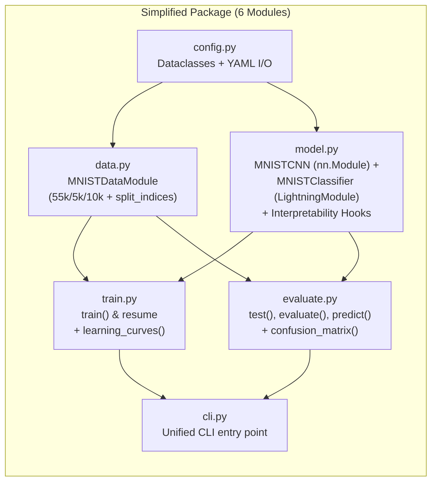

# Simplification & Interface Plan for `../MNIST_CNN`

This plan details how to simplify [`../MNIST_CNN`](file:///Users/frankelliott/Documents/Projects/Python/MNIST_CNN) and align it with a clean, reusable interface before (or during) its integration into [`src/models/MNIST/`](file:///Users/frankelliott/Documents/Projects/Python/interpetability/src/models/MNIST).

---

## 1. Diagnosis: What Makes `../MNIST_CNN` Complex Today?

[`../MNIST_CNN/src/mnist_cnn/`](file:///Users/frankelliott/Documents/Projects/Python/MNIST_CNN/src/mnist_cnn) currently spreads a simple 2-layer CNN across **13 files (~900 lines of code)** because it includes bespoke ceremony built for a standalone, stage-graded course project:

| Current Module | Lines | What It Does | Why It Should Be Simplified / Consolidated |
| :--- | ---: | :--- | :--- |
| [`config.py`](file:///Users/frankelliott/Documents/Projects/Python/MNIST_CNN/src/mnist_cnn/config.py) | 221 | Custom YAML AST loader (`_UniqueLoader`), regex secret redaction, manual type reflection (`_section`). | Standard Python `@dataclass` + `yaml.safe_load` accomplishes the same goal in ~60 lines without custom YAML parser hooks. |
| [`checkpoints.py`](file:///Users/frankelliott/Documents/Projects/Python/MNIST_CNN/src/mnist_cnn/checkpoints.py) | 121 | Custom `RunCheckpoint` subclassing `ModelCheckpoint`, custom `mnist_format_version=1` schema, manual `best_k_models` path rewriting, and `manifest.json` SHA-256 sidecars. | Lightning's built-in `ModelCheckpoint(save_top_k=1, save_last=True, monitor="val/loss")` and `LightningModule.load_from_checkpoint()` handle `best.ckpt`, `last.ckpt`, and `ckpt_path` resume natively. |
| [`runs.py`](file:///Users/frankelliott/Documents/Projects/Python/MNIST_CNN/src/mnist_cnn/runs.py) | 26 | Exclusive directory locking (`open("x")`) that refuses to reuse or overwrite any directory with existing files. | Friction-heavy during iterative experimentation and MLflow runs; standard `Path.mkdir(parents=True, exist_ok=True)` with optional unique run naming is much cleaner. |
| [`page_export.py`](file:///Users/frankelliott/Documents/Projects/Python/MNIST_CNN/src/mnist_cnn/page_export.py) | 132 | Custom HTML template generator + subprocess Playwright Chromium launcher for A4 PDF/PNG export. | Marimo natively supports HTML/PDF/IPYNB export (`marimo export html`), and plots are already saved as PNGs (`learning_curves.png`, `confusion_matrix.png`). Removes the `playwright` + Chromium browser dependency entirely. |
| [`model_inspection.py`](file:///Users/frankelliott/Documents/Projects/Python/MNIST_CNN/src/mnist_cnn/model_inspection.py) + [`workflows.py`](file:///Users/frankelliott/Documents/Projects/Python/MNIST_CNN/src/mnist_cnn/workflows.py) + [`demo.py`](file:///Users/frankelliott/Documents/Projects/Python/MNIST_CNN/src/mnist_cnn/demo.py) + [`validation.py`](file:///Users/frankelliott/Documents/Projects/Python/MNIST_CNN/src/mnist_cnn/validation.py) | 160 | Single-function files (`inspect_model`, `prepare_data`, `inspect_data`, `train_demo`, `confusion_matrix`). | Fragmented across 4 tiny files; naturally belong as methods or concise helpers inside `model.py`, `data.py`, and `evaluate.py`. |

---

## 2. Target Simplified Architecture (6 Core Modules)

We reduce the 13 modules down to **6 cohesive, idiomatic PyTorch Lightning modules** that also expose a clean, uniform interface for interpretability and MLOps:

### Module-by-Module Breakdown

#### 1. `config.py` (~70 lines, down from 221)
- Keep the clean nested `@dataclass` structure (`Config`, `DataConfig`, `ModelConfig`, `OptimizerConfig`, `TrainerConfig`, `TrackingConfig`).
- Replace the custom YAML AST constructor (`_UniqueLoader`) and manual type-checking boilerplate with standard `yaml.safe_load`, dataclass construction, and a concise `validate()` method.
- Support `Config.from_yaml(path, **overrides)` and `config.to_yaml(path)`.

#### 2. `data.py` (~120 lines, down from 180 across `data.py` + `workflows.py`)
- Keep `MNISTDataModule(pl.LightningDataModule)` with the deterministic 55,000 / 5,000 / 10,000 split, `seed_worker`, `save_split_indices()`, and `state_dict()` / `load_state_dict()`.
- Fold `prepare_data()` and `inspect_data()` directly into `data.py` (or as methods on `MNISTDataModule`).

#### 3. `model.py` (~130 lines, combining `model.py` + `module.py` + `model_inspection.py`)
- **`MNISTCNN(nn.Module)`**:
  - Keep the clean `nn.Sequential(OrderedDict([...]))` architecture (`conv1`, `relu1`, `pool1`, `conv2`, `relu2`, `pool2`, `flatten`, `hidden`, `relu3`, `dropout`, `logits`).
  - **Add Interpretability Interface Hooks**:
    - `get_last_conv_layer() -> nn.Module`: Returns `self.layers.conv2` (for Grad-CAM).
    - `get_feature_maps(images: torch.Tensor) -> dict[str, torch.Tensor]`: Extracts intermediate activations (`conv1`, `pool1`, `conv2`, `pool2`, `hidden`) via forward pass or hooks.
- **`MNISTClassifier(pl.LightningModule)`**:
  - Wraps `MNISTCNN`, `MulticlassAccuracy(num_classes=10, average="micro")` across `train`/`val`/`test`, `Adam` optimizer, and forwards `get_feature_maps()` / `get_last_conv_layer()`.
  - Standard `MNISTClassifier.load_from_checkpoint(ckpt_path)` works natively without custom `checkpoints.py` wrappers.

#### 4. `train.py` (~100 lines, replacing `learning.py` + `checkpoints.py` + `runs.py` + `demo.py`)
- Use Lightning's standard `ModelCheckpoint(dirpath=output / "checkpoints", filename="best", monitor="val/loss", mode="min", save_top_k=1, save_last=True, auto_insert_metric_name=False)` and `EarlyStopping`.
- Eliminate custom `RunCheckpoint` state-dict path rewriting and `mnist_format_version` ceremony.
- Keep `learning_curves(metrics_csv, output_png)` and `training_summary.json` generation (including optional SHA-256 hash of `best.ckpt` and `last.ckpt`).
- Support both full training, smoke runs (`limit_train_batches` / `limit_val_batches`), and `resume` (`trainer.fit(model, datamodule=data, ckpt_path=resume)`), plus `train_demo()` for the Marimo notebook.

#### 5. `evaluate.py` (~100 lines, combining `test_checkpoint` + `validation.py` + `predict`)
- `test_checkpoint(checkpoint_path, ...)`: Runs `Trainer.test` and saves `metrics.json`.
- `confusion_matrix(model, dataset)`: Computes the $10 \times 10$ confusion matrix on validation or test splits.
- `predict(model, images)`: Convenience inference helper returning predicted labels, probabilities, and logits.
- Ready to host Stage 7 rich evaluation (`report.md`, `predictions.csv`, `misclassified.png`) cleanly.

#### 6. `cli.py` (~80 lines)
- Clean `argparse` dispatcher supporting `prepare-data`, `inspect-data`, `inspect-model`, `train`, `test`, and `evaluate`.

---

## 3. Notebook Simplification (`notebooks/mnist_demo.py`)

1. **Remove `page_export.py` and `playwright` dependency**:
   - Drop the custom subprocess Chromium PDF/PNG export form at the bottom of [`notebooks/mnist_demo.py`](file:///Users/frankelliott/Documents/Projects/Python/MNIST_CNN/notebooks/mnist_demo.py#L304-L357).
   - Keep `marimo export html notebooks/mnist_demo.py -o runs/mnist_demo.html` for static snapshots.
   - Keep the interactive training form, run selector, digit browser + probability bar chart, learning curve viewer, full 5,000-sample validation confusion matrix heatmap, and architecture summary.
2. **Result**:
   - `notebooks` dependency group only needs `marimo>=0.19` (no `playwright`, no `.browser-cache` Chromium binary).

---

## 4. Test Suite Simplification (`tests/`)

Consolidate the 8 test files (which heavily tested custom YAML AST errors, `RunCheckpoint` path remapping, and Playwright subprocess rendering) into **4 focused, fast pytest modules**:

| Test File | What It Verifies |
| :--- | :--- |
| `tests/conftest.py` | Synthetic MNIST fixture and `--run-integration` marker. |
| `tests/test_config_and_data.py` | Dataclass/YAML config loading, overrides, deterministic 55k/5k/10k `MNISTDataModule` splits, `split_indices.json` round-trip, and cached integration check. |
| `tests/test_model.py` | `MNISTCNN` forward shapes (`[N, 10]`), loss/gradients, `get_feature_maps()`, and `get_last_conv_layer()`. |
| `tests/test_train_and_eval.py` | `MNISTClassifier` training, validation, `best.ckpt`/`last.ckpt` saving, resume from checkpoint, `test_checkpoint`, `confusion_matrix`, `predict`, and CLI commands. |

---

## 5. Summary of Reductions

| Metric | Current `../MNIST_CNN` | Simplified Design |
| :--- | :--- | :--- |
| **Source modules** | 13 files (~900 LOC) | **6 files (~500 LOC)** |
| **Test files** | 8 files (+ Playwright mocks) | **4 files (pure PyTorch/Lightning)** |
| **External browser deps** | `playwright` + Chromium binary | **None** (`marimo` only) |
| **Checkpointing** | Custom `RunCheckpoint` + custom format version | **Standard Lightning `ModelCheckpoint` (`best.ckpt` + `last.ckpt`)** |
| **Interpretability hooks** | None | **`get_feature_maps()` + `get_last_conv_layer()` built in** |

---

## 6. Execution Steps

1. **Step 1 — Simplify `config.py` & `data.py`**: Replace custom YAML AST parsing with standard dataclass + `yaml.safe_load`, and merge data preparation/inspection helpers into `data.py`.
2. **Step 2 — Unify `model.py`**: Combine `MNISTCNN`, `MNISTClassifier`, `inspect_model`, and add `get_feature_maps()` + `get_last_conv_layer()`.
3. **Step 3 — Simplify `train.py` & `evaluate.py`**: Replace `learning.py`, `checkpoints.py`, `runs.py`, `demo.py`, and `validation.py` with standard Lightning `ModelCheckpoint` workflows in `train.py` and evaluation/inference helpers in `evaluate.py`.
4. **Step 4 — Simplify `notebooks/mnist_demo.py` & `pyproject.toml`**: Remove `page_export.py` and `playwright`, keeping pure `marimo`.
5. **Step 5 — Consolidate `tests/` & Verify**: Run `uv run pytest` (synthetic + `--run-integration`) and verify CLI + Marimo notebook execution.
