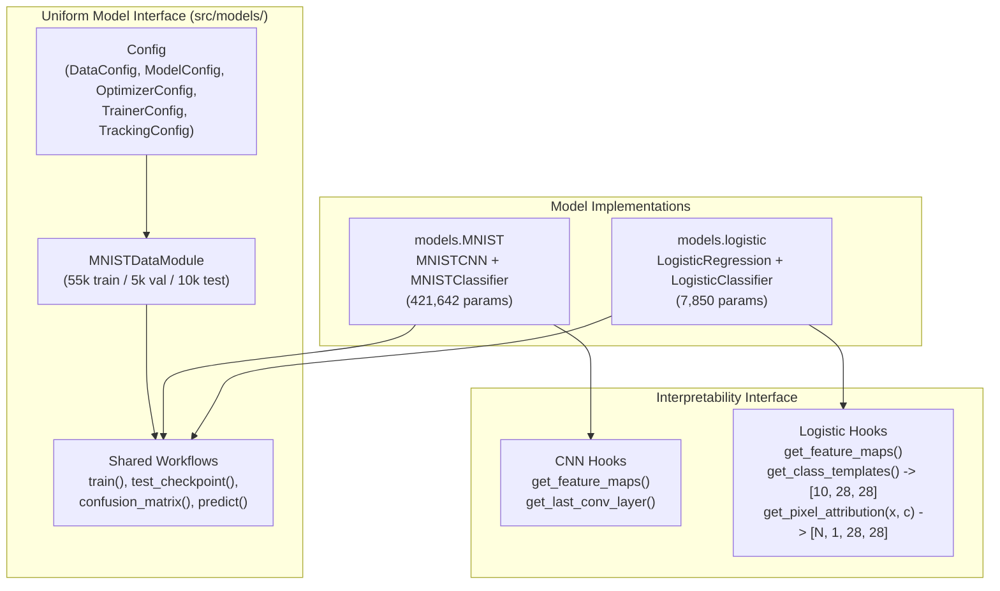

# Implementation Plan: Logistic Regression Model (`models.logistic`)

This plan details the design and implementation of a fast, glass-box **Multinomial Logistic Regression** model in PyTorch Lightning (`src/models/logistic/`). It serves three core purposes in this repository:
1. **Deployment & MLOps Harness Smoke Testing**: Exercises 100% of the PyTorch Lightning, checkpointing, MariaDB, RustFS, and MLflow pipeline in milliseconds on CPU (only 7,850 parameters on MNIST).
2. **Multi-Model Interface Validation**: Proves that `src/models/` supports multiple models sharing a uniform training, evaluation, CLI, and notebook contract.
3. **Glass-Box Interpretability Baseline**: Provides exact linear class templates ($W_c \in \mathbb{R}^{28 \times 28}$) and exact pixel-level feature attributions ($W_c \odot x$) to benchmark against non-linear CNN attributions (e.g., Grad-CAM).

---

## 1. Architecture & Shared Interface



### Mathematical Formulation
Given a normalized input image batch $x \in \mathbb{R}^{N \times 1 \times 28 \times 28}$:
1. **Flatten**: $z = \text{flatten}(x) \in \mathbb{R}^{N \times 784}$
2. **Linear Projection (Logits)**: $\ell = z W^\top + b \in \mathbb{R}^{N \times 10}$, where $W \in \mathbb{R}^{10 \times 784}$ and $b \in \mathbb{R}^{10}$
3. **Loss (Cross-Entropy with Optional $L_2$ Weight Decay)**:
   $$\mathcal{L}(\theta) = -\frac{1}{N} \sum_{i=1}^N \log \frac{\exp(\ell_{i, y_i})}{\sum_{c=0}^9 \exp(\ell_{i, c})} + \frac{\lambda}{2} \|W\|_F^2$$

---

## 2. Package Layout (`src/models/logistic/`)

To keep the implementation minimal and avoid duplicating data loading or training loop boilerplate, `src/models/logistic/` reuses `MNISTDataModule` and the core training/evaluation runners while providing its own model, configuration defaults, interpretability methods, and CLI entry point:

```text
configs/
    logistic.yaml                  # Baseline configuration for Logistic Regression
src/models/logistic/
    __init__.py                    # Public exports for models.logistic
    __main__.py                    # python -m models.logistic entry point
    model.py                       # LogisticRegression (nn.Module) + LogisticClassifier (LightningModule)
    train.py                       # Training, resume, and inspect_model workflows
    evaluate.py                    # Checkpoint loading, testing, confusion_matrix, predict
    cli.py                         # CLI entry point (logistic-mnist / python -m models.logistic)
doc/md/models/logistic/
    spec/
        implementation_plan.md     # This plan
tests/
    test_logistic.py               # Unit & integration tests for models.logistic
```

---

## 3. Component Design

### 3.1 Model & Interpretability (`src/models/logistic/model.py`)

#### `LogisticRegression(nn.Module)`
- **Parameters**:
  - `input_shape: tuple[int, int, int] = (1, 28, 28)` (784 features)
  - `num_classes: int = 10`
  - `bias: bool = True`
- **Layers** (`self.layers = nn.Sequential(OrderedDict(...))`):
  - `flatten`: `nn.Flatten(start_dim=1)` $\rightarrow$ `[N, 784]`
  - `logits`: `nn.Linear(784, 10, bias=bias)` $\rightarrow$ `[N, 10]`
- **Total Trainable Parameters**: $784 \times 10 + 10 = \mathbf{7,850}$.
- **Interpretability Methods**:
  - `get_feature_maps(images: torch.Tensor) -> dict[str, torch.Tensor]`:
    - Returns `{"flatten": Tensor[N, 784], "logits": Tensor[N, 10]}` (matching the `MNISTCNN.get_feature_maps` contract).
  - `get_class_templates() -> torch.Tensor`:
    - Reshapes the learned weight matrix $W \in \mathbb{R}^{10 \times 784}$ into $\mathbb{R}^{10 \times 28 \times 28}$ class weight templates (one $28 \times 28$ spatial filter per digit $0\dots9$).
  - `get_pixel_attribution(images: torch.Tensor, target_class: int | torch.Tensor | None = None) -> torch.Tensor`:
    - Computes exact linear pixel attribution $A_{i} = x_i \odot W_{c_i}$ shaped `[N, 1, 28, 28]` for the target (or predicted) digit class $c_i$.

#### `LogisticClassifier(pl.LightningModule)`
- Mirrors `MNISTClassifier` so it is a drop-in replacement in `Trainer.fit()`, `Trainer.test()`, `predict()`, and the Marimo notebook:
  - Saves `{"config": config_dict(self.config)}` in `self.save_hyperparameters()`.
  - Logs `train/loss`, `train/accuracy`, `val/loss`, `val/accuracy`, `test/loss`, `test/accuracy`, and `test/count` with `MulticlassAccuracy(num_classes=10, average="micro")`.
  - Configures `Adam` (or `SGD`) using `config.optimizer.learning_rate` and `config.optimizer.weight_decay`.
  - Exposes `get_feature_maps()`, `get_class_templates()`, and `get_pixel_attribution()`.

### 3.2 Configuration (`configs/logistic.yaml`)
Uses the same `Config` schema in [`src/models/MNIST/config.py`](file:///Users/frankelliott/Documents/Projects/Python/interpetability/src/models/MNIST/config.py) (with an optional `model.architecture: "logistic"` or `model.dropout: 0.0`):
```yaml
data:
  directory: data
  download: true
  split_seed: 42
  batch_size: 64
  num_workers: 0
  mean: 0.1307
  std: 0.3081
  split_indices: null
model:
  dropout: 0.0
optimizer:
  learning_rate: 0.001
  weight_decay: 0.0001
trainer:
  seed: 42
  max_epochs: 10
  accelerator: auto
  devices: 1
  precision: 32-true
  deterministic: true
  patience: 3
  limit_train_batches: null
  limit_val_batches: null
tracking:
  enabled: false
  uri: null
  experiment_name: mnist-logistic
  run_name: null
  tags: {}
output_dir: null
```

### 3.3 Training, Evaluation & CLI (`train.py`, `evaluate.py`, `cli.py`)
- **`train(config, output, resume=None)`**:
  - Uses `MNISTDataModule` and Lightning's `Trainer` + `ModelCheckpoint` (`best.ckpt`, `last.ckpt`, `manifest.json`) + `CSVLogger` + `learning_curves.png` + `training_summary.json`.
- **`test_checkpoint(config, output, checkpoint_path)`**, **`confusion_matrix(model, dataset)`**, and **`predict(model, images)`**:
  - Identical output schema (`metrics.json` and prediction dictionary) to `models.MNIST`.
- **CLI (`python -m models.logistic` or `mnist-logistic`)**:
  - Supports the same subcommands: `check-config`, `prepare-data`, `inspect-data`, `inspect-model`, `train`, and `test`.
  - Top-level `models` CLI (`src/models/main.py`) can also dispatch `--model mnist` vs `--model logistic`.

---

## 4. Verification & Testing Plan (`tests/test_logistic.py`)

1. **Architecture & Parameter Count**:
   - Verify `LogisticRegression` outputs `[N, 10]` finite logits for batch sizes 1, 7, and 64, and has exactly `7,850` parameters.
2. **Glass-Box Interpretability Hooks**:
   - Verify `get_class_templates()` returns shape `(10, 28, 28)`.
   - Verify `get_pixel_attribution(images, target_class)` returns shape `(N, 1, 28, 28)` and that summing attribution over all $28 \times 28$ pixels plus the class bias equals the exact class logit ($\sum_{h,w} A_{i,h,w} + b_c = \ell_{i,c}$).
3. **End-to-End Training, Resume, Testing & Prediction**:
   - Run 2 epochs on the synthetic `TinyMNIST` fixture $\rightarrow$ verify `best.ckpt`, `last.ckpt`, `manifest.json`, `learning_curves.png`, and `training_summary.json`.
   - Resume from `last.ckpt` to epoch 3 $\rightarrow$ verify epoch progression.
   - Run `test` on `best.ckpt` $\rightarrow$ verify `metrics.json`.
   - Run `predict()` and `confusion_matrix()`.
4. **Deployment Smoke Check**:
   - Verify a 2-epoch CPU smoke run (`--limit-train-batches 20 --limit-val-batches 5`) finishes in $< 0.5\text{s}$ and produces all expected artifacts for MLOps container verification.

---

## 5. Implementation Steps

| Step | Task | Target Files |
| :--- | :--- | :--- |
| **1** | Create `LogisticRegression`, `LogisticClassifier`, interpretability hooks (`get_class_templates`, `get_pixel_attribution`), and `inspect_model` | `src/models/logistic/model.py` |
| **2** | Wire up training, checkpoint resume, evaluation, and CLI for `models.logistic` | `src/models/logistic/train.py`, `evaluate.py`, `cli.py`, `__init__.py`, `__main__.py` |
| **3** | Add baseline YAML config and register `mnist-logistic` script | `configs/logistic.yaml`, `pyproject.toml`, `src/models/main.py` |
| **4** | Implement unit & mathematical attribution verification tests | `tests/test_logistic.py` |
| **5** | Run `uv run pytest` and verify CLI smoke execution | Terminal verification |
